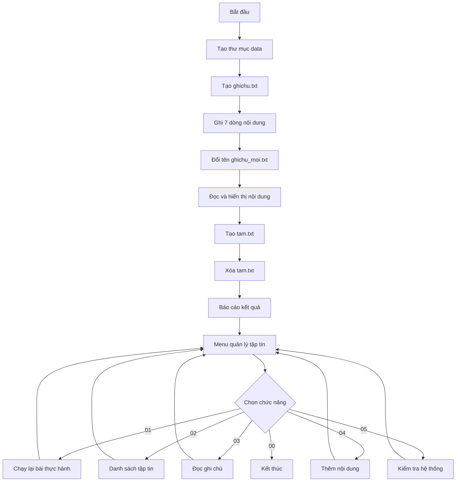
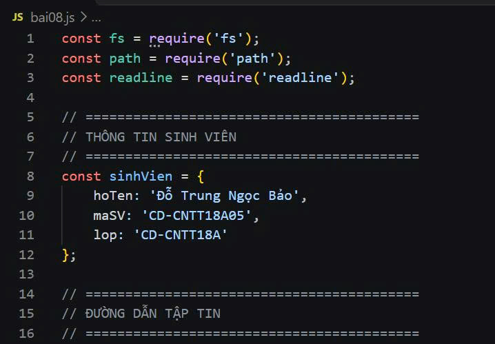
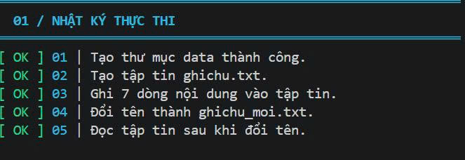
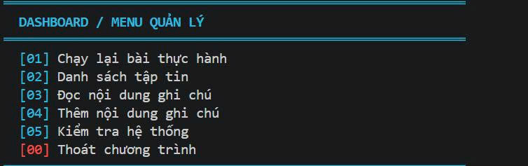
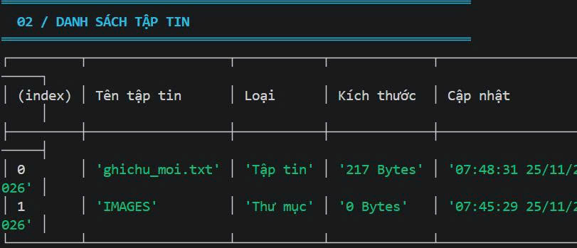
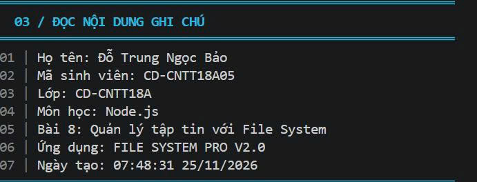
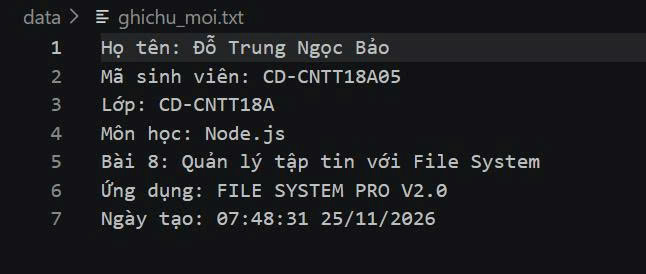

# 📂 BÀI TẬP 08 – QUẢN LÝ TẬP TIN VỚI FILE SYSTEM

<div align="center">

# 🚀 FILE SYSTEM PRO V2.0


**ỨNG DỤNG QUẢN LÝ TẬP TIN BẰNG NODE.JS**

**Đỗ Trung Ngọc Bảo | CD-CNTT18A05**

</div>

---

## 1. 👨‍💻 THÔNG TIN SINH VIÊN

| Thông tin | Nội dung |
|---|---|
| Họ và tên | Đỗ Trung Ngọc Bảo |
| Mã sinh viên | CD-CNTT18A05 |
| Lớp | CD-CNTT18A |
| Chuyên ngành | Công nghệ thông tin |
| Môn học | Node.js |
| Bài học | Bài 3 – Module, File System và cơ sở dữ liệu |
| Bài tập | Bài 8 – Quản lý tập tin với File System |
| Tên ứng dụng | FILE SYSTEM PRO V2.0 |
| Tập tin mã nguồn | bai08.js |

---

## 2. 📋 YÊU CẦU ĐỀ BÀI

Tạo tập tin `bai08.js` thực hiện các yêu cầu:

- Sử dụng module fs tạo thư mục data và tập tin ghichu.txt.
- Ghi vào tập tin ít nhất 3 dòng nội dung.
- Đổi tên tập tin thành ghichu_moi.txt bằng fs.rename().
- Đọc và hiển thị nội dung sau khi đổi tên.
- Tạo tập tin tam.txt.
- Xóa tập tin tam.txt bằng fs.unlink().
- Hiển thị thông báo kết quả từng thao tác.

Lệnh chạy chương trình:

```bash
node bai08.js
```

### Yêu cầu nộp bài

- Repository: NodeJS.
- Thư mục bài học: Bai03.
- Thư mục bài tập: Bt08.
- Có tập tin mã nguồn bai08.js.
- Có tập tin Readme.md.
- Có hình ảnh mã nguồn, quá trình thực thi và kết quả.
- Mã nguồn và đường dẫn thực thi mang thông tin cá nhân.

---

## 3. 🎯 MỤC TIÊU BÀI THỰC HÀNH

- Hiểu cách sử dụng module File System trong Node.js.
- Biết cách tạo thư mục và tập tin.
- Biết cách ghi dữ liệu vào tập tin.
- Biết cách đọc nội dung tập tin.
- Biết cách đổi tên và xóa tập tin.
- Hiểu cách sử dụng đường dẫn với module path.
- Làm quen với xử lý bất đồng bộ Async/Await.
- Biết cách xử lý lỗi bằng Try/Catch.
- Xây dựng chương trình tương tác với người dùng.
- Nâng cao kỹ năng lập trình JavaScript.

---

## 4. 💡 GIỚI THIỆU ỨNG DỤNG

FILE SYSTEM PRO V2.0 là chương trình quản lý tập tin được xây dựng bằng Node.js.

Ứng dụng tự động thực hiện 7 thao tác File System theo yêu cầu đề bài.

Sau khi hoàn thành, chương trình hiển thị menu quản lý cho phép người dùng lựa chọn các chức năng mở rộng.

### Điểm nổi bật

- Giao diện Terminal có màu sắc.
- Hiển thị thông tin sinh viên.
- Nhật ký thực thi từng thao tác.
- Báo cáo kết quả thực hiện.
- Thanh tiến trình hoàn thành.
- Menu quản lý tương tác.
- Bảng danh sách tập tin.
- Hiển thị kích thước tập tin.
- Hiển thị thời gian chỉnh sửa.
- Đọc nội dung có đánh số dòng.
- Thêm nội dung ghi chú.
- Kiểm tra trạng thái hệ thống.
- Xử lý lỗi trong quá trình thực thi.

---

## 5. 🛠️ CÔNG NGHỆ SỬ DỤNG

| Công nghệ | Vai trò |
|---|---|
| Node.js | Môi trường thực thi JavaScript |
| JavaScript | Ngôn ngữ lập trình |
| File System (fs) | Quản lý thư mục và tập tin |
| Path | Xử lý đường dẫn |
| Readline | Nhận dữ liệu từ bàn phím |
| Promise | Xử lý thao tác bất đồng bộ |
| Async/Await | Điều khiển trình tự thực thi |
| Try/Catch | Xử lý ngoại lệ |
| ANSI Color | Hiển thị màu sắc Terminal |
| Visual Studio Code | Soạn thảo mã nguồn |
| GitHub | Lưu trữ và nộp bài tập |

Chương trình sử dụng các module tích hợp sẵn của Node.js, không cần cài đặt thêm thư viện bên ngoài.

---

## 6. 📦 CÁC MODULE SỬ DỤNG

### 6.1. Module File System

```javascript
const fs = require("fs");
```

Module fs cung cấp các chức năng thao tác với thư mục và tập tin trên máy tính.

### 6.2. Module Path

```javascript
const path = require("path");
```

Module path hỗ trợ tạo và xử lý đường dẫn tập tin.

Sử dụng đường dẫn dựa trên __dirname giúp chương trình xác định đúng thư mục chứa mã nguồn.

### 6.3. Module Readline

```javascript
const readline = require("readline");
```

Module readline giúp chương trình nhận lựa chọn và nội dung nhập từ bàn phím.

---

## 7. 📚 GIẢI THÍCH CÁC LỆNH SỬ DỤNG

| Lệnh | Công dụng |
|---|---|
| fs.mkdir() | Tạo thư mục |
| fs.writeFile() | Tạo hoặc ghi nội dung tập tin |
| fs.rename() | Đổi tên tập tin |
| fs.readFile() | Đọc nội dung tập tin |
| fs.unlink() | Xóa tập tin |
| fs.promises.readdir() | Đọc danh sách tập tin |
| fs.promises.stat() | Lấy thông tin tập tin |
| fs.promises.readFile() | Đọc tập tin bằng Promise |
| fs.promises.appendFile() | Ghi thêm nội dung |
| fs.existsSync() | Kiểm tra tập tin tồn tại |
| path.join() | Kết hợp các thành phần đường dẫn |
| console.log() | Hiển thị thông báo |
| console.table() | Hiển thị dữ liệu dạng bảng |
| Buffer.byteLength() | Tính kích thước dữ liệu theo byte |
| new Date() | Lấy ngày giờ hiện tại |
| process.version | Lấy phiên bản Node.js |
| process.platform | Lấy thông tin nền tảng hệ điều hành |

---

## 8. ⚙️ QUY TRÌNH THỰC HIỆN 7 THAO TÁC

### Bước 01 – Tạo thư mục data

Sử dụng fs.mkdir() để tạo thư mục chứa dữ liệu.

Ví dụ minh họa:

```javascript
fs.mkdir("data", { recursive: true }, (err) => {
    if (err) {
        console.log(err);
    } else {
        console.log("Tạo thư mục thành công");
    }
});
```

### Bước 02 – Tạo tập tin ghichu.txt

Sử dụng fs.writeFile() để tạo tập tin ghi chú trong thư mục data.

```javascript
fs.writeFile("data/ghichu.txt", "", (err) => {
    if (err) {
        console.log(err);
    } else {
        console.log("Tạo tập tin thành công");
    }
});
```

### Bước 03 – Ghi nội dung tập tin

Ghi 7 dòng thông tin vào tập tin ghichu.txt.

Nội dung bao gồm:

```text
Họ tên: Đỗ Trung Ngọc Bảo
Mã sinh viên: CD-CNTT18A05
Lớp: CD-CNTT18A
Môn học: Node.js
Bài 8: Quản lý tập tin với File System
Ứng dụng: FILE SYSTEM PRO V2.0
Ngày tạo: Thời gian thực thi chương trình
```

Chương trình ghi 7 dòng nội dung, đáp ứng yêu cầu tối thiểu 3 dòng của đề bài.

### Bước 04 – Đổi tên tập tin

Sử dụng fs.rename() để đổi tên:

```text
ghichu.txt → ghichu_moi.txt
```

Ví dụ minh họa:

```javascript
fs.rename(
    "data/ghichu.txt",
    "data/ghichu_moi.txt",
    (err) => {
        if (err) {
            console.log(err);
        } else {
            console.log("Đổi tên thành công");
        }
    }
);
```

### Bước 05 – Đọc nội dung tập tin

Sử dụng fs.readFile() để đọc tập tin sau khi đổi tên.

```javascript
fs.readFile(
    "data/ghichu_moi.txt",
    "utf8",
    (err, data) => {
        if (err) {
            console.log(err);
        } else {
            console.log(data);
        }
    }
);
```

### Bước 06 – Tạo tập tin tạm

Tạo tập tin tam.txt bằng fs.writeFile().

```javascript
fs.writeFile("data/tam.txt", "Tập tin tạm", (err) => {
    if (err) {
        console.log(err);
    } else {
        console.log("Tạo tập tin tạm thành công");
    }
});
```

### Bước 07 – Xóa tập tin tạm

Sử dụng fs.unlink() để xóa tập tin tam.txt.

```javascript
fs.unlink("data/tam.txt", (err) => {
    if (err) {
        console.log(err);
    } else {
        console.log("Xóa tập tin tạm thành công");
    }
});
```

Các đoạn mã trên minh họa từng lệnh File System. Mã nguồn chính trong bai08.js sử dụng Promise và Async/Await để thực hiện các thao tác theo đúng trình tự.

---

## 9. 🔄 SƠ ĐỒ HOẠT ĐỘNG



---

## 10. 🖥️ MENU QUẢN LÝ TẬP TIN

```text
================================================
           FILE SYSTEM PRO V2.0
================================================

[01] Chạy lại bài thực hành
[02] Danh sách tập tin
[03] Đọc nội dung ghi chú
[04] Thêm nội dung ghi chú
[05] Kiểm tra hệ thống
[00] Thoát chương trình

================================================
Nhập lựa chọn:
```

### Chức năng 01 – Chạy lại bài thực hành

- Thực hiện lại 7 thao tác File System.
- Yêu cầu xác nhận trước khi thực hiện.
- Tạo lại nội dung ghi chú mẫu.
- Hiển thị báo cáo kết quả.

### Chức năng 02 – Danh sách tập tin

- Liệt kê các mục trong thư mục data.
- Hiển thị tên tập tin.
- Hiển thị loại tập tin.
- Hiển thị kích thước.
- Hiển thị thời gian chỉnh sửa.
- Hiển thị tổng số mục.

### Chức năng 03 – Đọc nội dung ghi chú

- Đọc tập tin ghichu_moi.txt.
- Hiển thị nội dung có đánh số dòng.
- Thống kê số dòng.
- Hiển thị kích thước dữ liệu.

### Chức năng 04 – Thêm nội dung ghi chú

- Cho phép nhập nội dung mới từ bàn phím.
- Kiểm tra nội dung nhập.
- Kiểm tra tập tin tồn tại.
- Sử dụng appendFile() để ghi thêm nội dung.

### Chức năng 05 – Kiểm tra hệ thống

- Kiểm tra thư mục data.
- Kiểm tra tập tin ghichu.txt.
- Kiểm tra tập tin ghichu_moi.txt.
- Kiểm tra tập tin tam.txt.
- Hiển thị phiên bản Node.js.
- Hiển thị thông tin hệ điều hành.
- Hiển thị đường dẫn chương trình.

### Chức năng 00 – Thoát chương trình

- Kết thúc menu quản lý.
- Đóng giao diện Readline.
- Thoát chương trình.

---

## 11. 📁 CẤU TRÚC THƯ MỤC

```text
NodeJS/
│
└── Bai03/
    │
    └── Bt08/
        │
        ├── data/
        │   └── ghichu_moi.txt
        │
        ├── IMAGES/
        │   ├── 01-Code.png
        │   ├── 02-ThucThi.png
        │   ├── 03-Menu.png
        │   ├── 04-DanhSach.png
        │   ├── 05-NoiDung.png
        │   └── 06-KetQua.png
        │
        ├── bai08.js
        └── Readme.md
```

### Giải thích

| Tập tin / Thư mục | Chức năng |
|---|---|
| bai08.js | Mã nguồn chính |
| data/ | Thư mục lưu trữ dữ liệu |
| ghichu_moi.txt | Tập tin ghi chú sau khi đổi tên |
| IMAGES/ | Lưu hình ảnh minh chứng |
| Readme.md | Tài liệu mô tả bài thực hành |

---

## 12. 🚀 HƯỚNG DẪN CÀI ĐẶT VÀ THỰC THI

### Bước 1 – Kiểm tra Node.js

Mở Terminal và nhập:

```bash
node -v
```

### Bước 2 – Mở thư mục bài tập

Mở Visual Studio Code và chọn:

```text
File → Open Folder → Bt08
```

### Bước 3 – Mở Terminal

```text
Terminal → New Terminal
```

### Bước 4 – Di chuyển đến đường dẫn cá nhân

```powershell
cd "D:\CD-CNTT18A DoTrungNgocBao\NodeJS\Bai03\Bt08"
```

### Bước 5 – Chạy chương trình

```bash
node bai08.js
```

### Bước 6 – Sử dụng chương trình

Sau khi chương trình thực hiện các thao tác File System, nhập mã chức năng tương ứng trong menu.

Ví dụ:

```text
Nhập lựa chọn: 02
```

Chương trình hiển thị danh sách tập tin.

```text
Nhập lựa chọn: 03
```

Chương trình hiển thị nội dung ghi chú.

### Lưu ý

- Không cần chạy npm install.
- Không cần kết nối cơ sở dữ liệu.
- Thư mục data được tạo tự động.
- Khi khởi động hoặc chạy lại bài thực hành, nội dung ghi chú được tạo lại theo dữ liệu mẫu.

---

## 13. 📸 HÌNH ẢNH MINH CHỨNG

### 13.1. Mã nguồn chương trình bai08.js

Mã nguồn được xây dựng bằng JavaScript trong Visual Studio Code, sử dụng các module fs, path và readline.



---

### 13.2. Kết quả thực hiện 7 thao tác File System

Chương trình hiển thị nhật ký từng thao tác và báo cáo tổng kết sau khi thực hiện.



---

### 13.3. Giao diện menu quản lý tập tin

Menu cung cấp các chức năng quản lý và kiểm tra tập tin.



---

### 13.4. Chức năng danh sách tập tin

Hiển thị thông tin các mục trong thư mục data dưới dạng bảng.



---

### 13.5. Chức năng đọc nội dung ghi chú

Hiển thị nội dung tập tin ghichu_moi.txt, số dòng và kích thước dữ liệu.



---

### 13.6. Kết quả tập tin ghichu_moi.txt

Tập tin kết quả chứa 7 dòng thông tin và được lưu trong thư mục data.



---

## 14. 📊 ĐÁNH GIÁ KẾT QUẢ

### 14.1. Các yêu cầu bắt buộc

| STT | Yêu cầu | Kết quả |
|---|---|---|
| 01 | Tạo thư mục data | Hoàn thành |
| 02 | Tạo ghichu.txt | Hoàn thành |
| 03 | Ghi ít nhất 3 dòng | Hoàn thành – 7 dòng |
| 04 | Đổi tên tập tin | Hoàn thành |
| 05 | Đọc nội dung tập tin | Hoàn thành |
| 06 | Tạo tam.txt | Hoàn thành |
| 07 | Xóa tam.txt | Hoàn thành |
| 08 | Hiển thị thông báo | Hoàn thành |

### 14.2. Các chức năng mở rộng

| Chức năng | Trạng thái |
|---|---|
| Giao diện Terminal màu sắc | Đã xây dựng |
| Thanh tiến trình | Đã xây dựng |
| Menu tương tác | Đã xây dựng |
| Danh sách tập tin | Đã kiểm tra |
| Đọc nội dung ghi chú | Đã kiểm tra |
| Thêm nội dung ghi chú | Đã xây dựng |
| Kiểm tra hệ thống | Đã xây dựng |
| Thoát chương trình | Đã xây dựng |
| Xử lý lỗi | Đã xây dựng |

Các chức năng mở rộng chưa được kiểm thử đầy đủ không được đánh giá là đã kiểm thử thành công.

---

## 15. 📈 KẾT QUẢ MONG ĐỢI

Sau khi thực hiện thành công:

| Thành phần | Trạng thái |
|---|---|
| Thư mục data | Tồn tại |
| ghichu.txt | Không còn sau khi đổi tên |
| ghichu_moi.txt | Tồn tại |
| tam.txt | Đã được xóa |
| Số dòng ghi chú mẫu | 7 dòng |
| Tiến độ thực hiện | 7/7 thao tác |
| Tỷ lệ hoàn thành thao tác | 100% |

---

## 16. 🛡️ XỬ LÝ LỖI

Chương trình sử dụng Try/Catch và Promise để xử lý các lỗi có thể phát sinh trong quá trình thực hiện.

Một số trường hợp được xử lý:

- Không thể tạo thư mục.
- Không thể tạo tập tin.
- Lỗi ghi nội dung.
- Lỗi đọc nội dung.
- Lỗi đổi tên tập tin.
- Lỗi xóa tập tin.
- Tập tin không tồn tại.
- Người dùng nhập lựa chọn không hợp lệ.
- Người dùng nhập nội dung trống.

Việc xử lý lỗi giúp chương trình hiển thị thông báo phù hợp khi xảy ra sự cố.

---

## 17. ⭐ ƯU ĐIỂM VÀ HẠN CHẾ

### Ưu điểm

- Bám sát nội dung bài học.
- Đáp ứng các yêu cầu File System.
- Có giao diện Terminal trực quan.
- Có menu quản lý tương tác.
- Có thông tin cá nhân sinh viên.
- Có khả năng mở rộng chức năng.
- Không phụ thuộc thư viện bên ngoài.
- Có hình ảnh minh chứng quá trình thực hiện.

### Hạn chế

- Chưa có giao diện đồ họa.
- Chưa hỗ trợ quản lý nhiều thư mục.
- Chưa có chức năng tìm kiếm tập tin.
- Chưa có chức năng sao lưu dữ liệu.
- Dữ liệu mẫu được tạo lại khi chạy bài thực hành.
- Một số chức năng mở rộng chưa được kiểm thử đầy đủ.

---

## 18. 🔮 HƯỚNG PHÁT TRIỂN

Trong tương lai, chương trình có thể được nâng cấp thêm:

- Tìm kiếm tập tin theo tên.
- Tạo tập tin theo yêu cầu người dùng.
- Đổi tên tập tin từ menu.
- Sao chép tập tin.
- Sao lưu và khôi phục dữ liệu.
- Quản lý nhiều thư mục.
- Lưu lịch sử thao tác.
- Xây dựng giao diện quản lý trên website.
- Kết hợp với cơ sở dữ liệu MongoDB.

---

## 19. 📖 TÀI LIỆU THAM KHẢO

- [Bài 3 – Module, File System và cơ sở dữ liệu](https://hoctructuyencntt.github.io/NodeJS/Bai03.html)
- [Node.js Documentation](https://nodejs.org/docs/latest/api/)
- [File System Documentation](https://nodejs.org/api/fs.html)
- [Path Documentation](https://nodejs.org/api/path.html)
- [Readline Documentation](https://nodejs.org/api/readline.html)
- [Visual Studio Code](https://code.visualstudio.com/)
- [GitHub](https://github.com/)

---

## 20. 📝 KẾT LUẬN

Qua bài thực hành quản lý tập tin với File System, em đã hiểu rõ hơn cách sử dụng các module tích hợp trong Node.js.

Em biết cách tạo thư mục, tạo tập tin, ghi dữ liệu, đọc dữ liệu, đổi tên và xóa tập tin bằng module fs.

Ngoài các yêu cầu cơ bản, em xây dựng thêm menu quản lý tương tác, giao diện Terminal màu sắc, báo cáo kết quả và các chức năng hỗ trợ quản lý tập tin.

Bài thực hành giúp em củng cố kiến thức JavaScript, Node.js, xử lý bất đồng bộ và nâng cao kỹ năng xây dựng ứng dụng thực tế.

---

<div align="center">

# 👨‍💻 THÔNG TIN TÁC GIẢ

### ĐỖ TRUNG NGỌC BẢO

**Mã sinh viên: CD-CNTT18A05**

**Lớp: CD-CNTT18A**

**Chuyên ngành: Công nghệ thông tin**

---

### 🚀 FILE SYSTEM PRO V2.0


**⭐ LEARN – CODE – CREATE – DEVELOP ⭐**

**CẢM ƠN THẦY ĐÃ XEM BÀI THỰC HÀNH!**

</div>