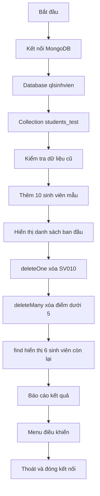
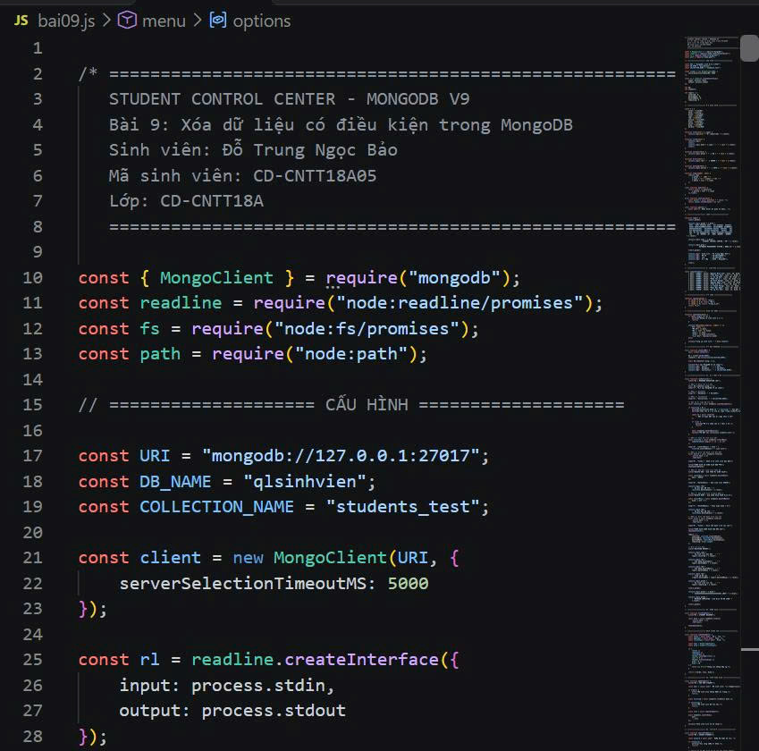
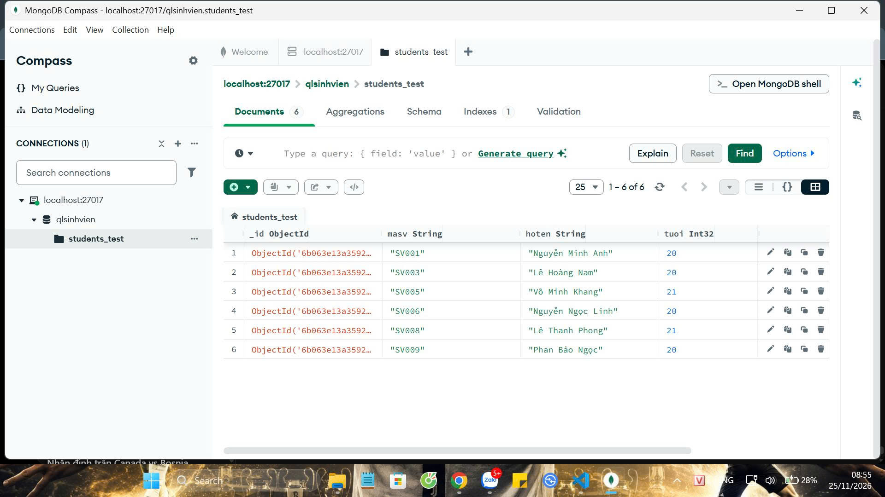
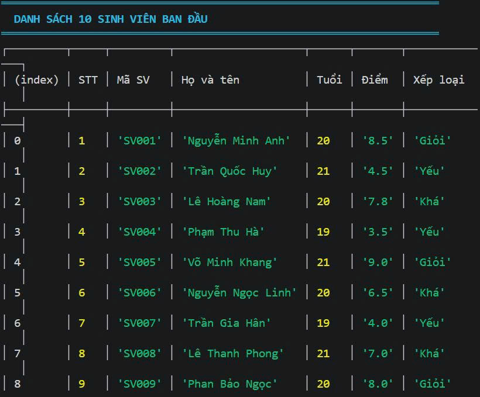
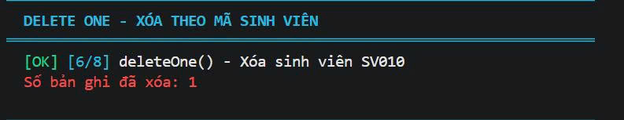
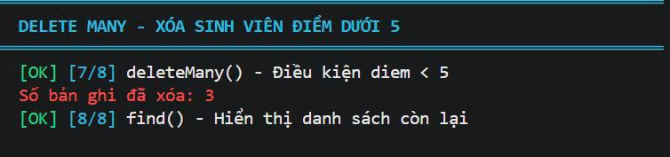
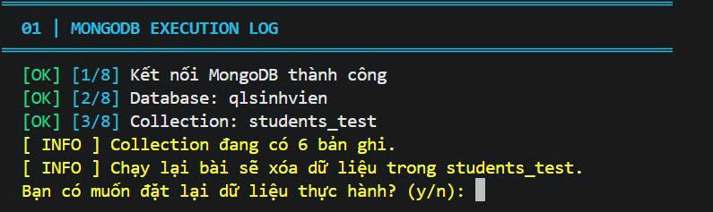
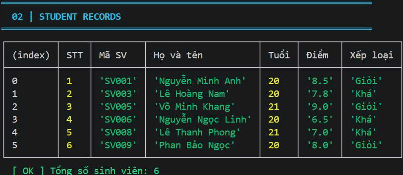

 # 🍃 STUDENT CONTROL CENTER – MONGODB V9

# BÀI 9: XÓA DỮ LIỆU CÓ ĐIỀU KIỆN TRONG MONGODB


---

## 1. THÔNG TIN SINH VIÊN

| Thông tin | Nội dung |
|---|---|
| Họ và tên | Đỗ Trung Ngọc Bảo |
| Mã sinh viên | CD-CNTT18A05 |
| Lớp | CD-CNTT18A |
| Môn học | NodeJS và MongoDB |
| Bài học | Bài 3 – Module, File System và cơ sở dữ liệu |
| Bài thực hành | Bài 9 – Xóa dữ liệu có điều kiện trong MongoDB |
| Tên chương trình | STUDENT CONTROL CENTER – MONGODB V9 |
| Tập tin thực thi | bai09.js |
| Database | qlsinhvien |
| Collection | students_test |

---

## 2. GIỚI THIỆU ĐỀ TÀI

STUDENT CONTROL CENTER – MONGODB V9 là chương trình quản lý dữ liệu sinh viên được xây dựng bằng Node.js kết hợp với hệ quản trị cơ sở dữ liệu MongoDB.

Chương trình tập trung vào các thao tác thêm, truy vấn và xóa dữ liệu có điều kiện trong MongoDB.

Ngoài các chức năng bắt buộc của bài thực hành, chương trình còn được mở rộng với hệ thống menu điều khiển, tìm kiếm, cập nhật, thống kê và xuất báo cáo sinh viên.

Giao diện chương trình được thiết kế trực tiếp trên Terminal với màu sắc, bảng dữ liệu, thông báo trạng thái kết nối và thanh tiến trình thực hiện.

---

## 3. YÊU CẦU BÀI THỰC HÀNH

Tạo tập tin bai09.js thực hiện các yêu cầu sau:

- [x] Kết nối database qlsinhvien.
- [x] Sử dụng collection riêng students_test.
- [x] Thêm ít nhất 5 sinh viên mẫu.
- [x] Mỗi sinh viên có masv, hoten, tuoi và diem.
- [x] Sử dụng deleteOne() để xóa một sinh viên theo mã.
- [x] Sử dụng deleteMany() để xóa sinh viên có điểm dưới 5.
- [x] Hiển thị số bản ghi đã xóa.
- [x] Hiển thị danh sách sinh viên còn lại bằng find().
- [x] Chạy chương trình bằng lệnh node bai09.js.

Chương trình sử dụng 10 sinh viên mẫu, nhiều hơn số lượng tối thiểu được yêu cầu.

---

## 4. CÔNG NGHỆ SỬ DỤNG

| Công nghệ | Mục đích sử dụng |
|---|---|
| Node.js | Môi trường thực thi JavaScript |
| JavaScript | Ngôn ngữ lập trình |
| MongoDB | Lưu trữ và quản lý dữ liệu |
| MongoDB Compass | Quan sát dữ liệu trực quan |
| MongoDB Driver | Kết nối Node.js với MongoDB |
| Visual Studio Code | Soạn thảo mã nguồn |
| Readline | Nhập dữ liệu từ Terminal |
| File System | Hỗ trợ xuất báo cáo |
| Path | Xử lý đường dẫn tập tin |
| ANSI Color | Hiển thị màu sắc trên Terminal |
| GitHub | Lưu trữ và nộp bài thực hành |

---

## 5. CẤU TRÚC THƯ MỤC

```text
NodeJS/
└── Bai03/
    └── Bt09/
        ├── bai09.js
        ├── package.json
        ├── package-lock.json
        ├── Readme.md
        ├── .gitignore
        └── IMAGES/
            ├── 01-Code.png
            ├── 02-MongoDB.png
            ├── 03-DanhSachBanDau.png
            ├── 04-DeleteOne.png
            ├── 05-DeleteMany.png
            ├── 06-KetQua.png
            ├── 07-Menu.png
            └── 08-DanhSachConLai.png
```

### Giải thích các tập tin

| Tập tin | Chức năng |
|---|---|
| bai09.js | Mã nguồn chính của chương trình |
| package.json | Thông tin dự án và thư viện |
| package-lock.json | Quản lý phiên bản thư viện |
| Readme.md | Báo cáo bài thực hành |
| .gitignore | Loại trừ các tập tin không cần đưa lên GitHub |
| IMAGES | Chứa ảnh minh chứng thực hành |
| node_modules | Thư viện được cài đặt bằng npm |

Thư mục node_modules không cần đưa lên GitHub.

---

## 6. MÔI TRƯỜNG THỰC HÀNH

- Hệ điều hành: Windows.
- Node.js: v26.13.0.
- MongoDB Community Server: 8.0.38.
- Công cụ lập trình: Visual Studio Code.
- Công cụ quản lý dữ liệu: MongoDB Compass.
- Máy chủ MongoDB: localhost.
- Cổng kết nối: 27017.

### Đường dẫn thực hành cá nhân

```text
D:\CD-CNTT18A DoTrungNgocBao\NodeJS\Bai03\Bt09
```

### Di chuyển đến thư mục bài thực hành

```powershell
cd "D:\CD-CNTT18A DoTrungNgocBao\NodeJS\Bai03\Bt09"
```

### Kiểm tra phiên bản Node.js

```powershell
node -v
```

### Kiểm tra phiên bản npm

```powershell
npm.cmd -v
```

---

## 7. HƯỚNG DẪN CÀI ĐẶT

### Bước 1: Khởi tạo dự án Node.js

```powershell
npm.cmd init -y
```

Lệnh trên tạo tập tin package.json để quản lý thông tin dự án.

### Bước 2: Cài đặt thư viện MongoDB

```powershell
npm.cmd install mongodb
```

Lệnh trên cài đặt MongoDB Driver để Node.js có thể kết nối và thao tác với cơ sở dữ liệu MongoDB.

Nếu tải dự án đã có package.json từ GitHub, chỉ cần thực hiện:

```powershell
npm.cmd install
```

### Bước 3: Khởi động MongoDB

Đảm bảo dịch vụ MongoDB Server đang hoạt động trên máy tính.

Mở MongoDB Compass và kết nối bằng địa chỉ:

```text
mongodb://localhost:27017
```

Thông tin cơ sở dữ liệu:

```text
Database: qlsinhvien
Collection: students_test
```

### Bước 4: Chạy chương trình

```powershell
node bai09.js
```

Chương trình tự động kết nối MongoDB, thực hiện bài thực hành và hiển thị kết quả.

---

## 8. THIẾT KẾ CƠ SỞ DỮ LIỆU

### 8.1. Thông tin cơ sở dữ liệu

| Thuộc tính | Giá trị |
|---|---|
| Database | qlsinhvien |
| Collection | students_test |
| Host | 127.0.0.1 |
| Port | 27017 |
| Số sinh viên mẫu | 10 |

### 8.2. Cấu trúc dữ liệu sinh viên

| Thuộc tính | Kiểu dữ liệu | Ý nghĩa |
|---|---|---|
| _id | ObjectId | Mã định danh tự động của MongoDB |
| masv | String | Mã sinh viên |
| hoten | String | Họ và tên sinh viên |
| tuoi | Number | Tuổi sinh viên |
| diem | Number | Điểm sinh viên |

### 8.3. Ví dụ một bản ghi

```javascript
{
    masv: "SV001",
    hoten: "Nguyễn Minh Anh",
    tuoi: 20,
    diem: 8.5
}
```

MongoDB tự động tạo thuộc tính _id cho mỗi document khi thêm dữ liệu.

---

## 9. GIẢI THÍCH CÁC MODULE SỬ DỤNG

### 9.1. MongoDB

```javascript
const { MongoClient } = require("mongodb");
```

Sử dụng MongoClient để kết nối Node.js với MongoDB.

### 9.2. Readline

```javascript
const readline = require("node:readline/promises");
```

Hỗ trợ nhập lựa chọn và thông tin sinh viên từ Terminal.

### 9.3. File System

```javascript
const fs = require("node:fs/promises");
```

Hỗ trợ tạo thư mục và ghi nội dung báo cáo ra tập tin.

### 9.4. Path

```javascript
const path = require("node:path");
```

Hỗ trợ xử lý đường dẫn khi xuất báo cáo.

---

## 10. GIẢI THÍCH CÁC LỆNH MONGODB

Các đoạn mã dưới đây minh họa những thao tác chính được sử dụng trong chương trình bai09.js.

### 10.1. Kết nối MongoDB

```javascript
const client = new MongoClient(
    "mongodb://127.0.0.1:27017"
);

await client.connect();

const db = client.db("qlsinhvien");

const students = db.collection("students_test");
```

Ý nghĩa:

- MongoClient: tạo đối tượng kết nối.
- connect(): kết nối máy chủ MongoDB.
- db(): lựa chọn database.
- collection(): lựa chọn collection.

### 10.2. Kiểm tra kết nối

```javascript
await db.command({ ping: 1 });
```

Lệnh ping giúp kiểm tra trạng thái hoạt động của MongoDB.

### 10.3. Đếm số lượng sinh viên

```javascript
const total = await students.countDocuments();
```

Hàm countDocuments() trả về số lượng document trong collection.

### 10.4. Thêm nhiều sinh viên

```javascript
const result = await students.insertMany(
    sampleStudents.map(sv => ({ ...sv }))
);
```

Hàm insertMany() được sử dụng để thêm nhiều document cùng lúc.

Thuộc tính insertedCount cho biết số bản ghi đã được thêm.

### 10.5. Hiển thị danh sách sinh viên

```javascript
const list = await students
    .find({})
    .sort({ masv: 1 })
    .toArray();

console.table(list);
```

Giải thích:

- find({}): truy vấn tất cả sinh viên.
- sort({ masv: 1 }): sắp xếp mã sinh viên tăng dần.
- toArray(): chuyển kết quả thành mảng.
- console.table(): hiển thị dữ liệu dưới dạng bảng.

### 10.6. Xóa một sinh viên theo mã

```javascript
const result = await students.deleteOne({
    masv: "SV010"
});

console.log(result.deletedCount);
```

Hàm deleteOne() xóa tối đa một document thỏa mãn điều kiện.

Trong bài thực hành, sinh viên có mã SV010 được xóa.

Kết quả:

```text
Số bản ghi đã xóa: 1
```

### 10.7. Xóa nhiều sinh viên có điểm dưới 5

```javascript
const result = await students.deleteMany({
    diem: { $lt: 5 }
});

console.log(result.deletedCount);
```

Hàm deleteMany() xóa tất cả document thỏa mãn điều kiện.

Toán tử $lt có nghĩa là nhỏ hơn (Less Than).

Điều kiện diem: { $lt: 5 } xác định những sinh viên có điểm dưới 5.

Kết quả:

```text
Số bản ghi đã xóa: 3
```

### 10.8. Hiển thị danh sách sau khi xóa

```javascript
const remaining = await students
    .find({})
    .sort({ masv: 1 })
    .toArray();

console.table(remaining);
```

Kết quả còn lại 6 sinh viên.

### 10.9. Đóng kết nối

```javascript
await client.close();
```

Đóng kết nối MongoDB khi kết thúc chương trình để giải phóng tài nguyên.

---

## 11. DANH SÁCH 10 SINH VIÊN BAN ĐẦU

| STT | Mã SV | Họ và tên | Tuổi | Điểm |
|---:|---|---|---:|---:|
| 1 | SV001 | Nguyễn Minh Anh | 20 | 8.5 |
| 2 | SV002 | Trần Quốc Huy | 21 | 4.5 |
| 3 | SV003 | Lê Hoàng Nam | 20 | 7.8 |
| 4 | SV004 | Phạm Thu Hà | 19 | 3.5 |
| 5 | SV005 | Võ Minh Khang | 21 | 9.0 |
| 6 | SV006 | Nguyễn Ngọc Linh | 20 | 6.5 |
| 7 | SV007 | Trần Gia Hân | 19 | 4.0 |
| 8 | SV008 | Lê Thanh Phong | 21 | 7.0 |
| 9 | SV009 | Phan Bảo Ngọc | 20 | 8.0 |
| 10 | SV010 | Hoàng Đức Anh | 22 | 5.5 |

Tổng số sinh viên ban đầu: 10.

---

## 12. QUY TRÌNH THỰC HIỆN CHƯƠNG TRÌNH



---

## 13. DANH SÁCH SINH VIÊN ĐÃ XÓA

### 13.1. Xóa bằng deleteOne()

| Mã SV | Họ và tên | Điểm |
|---|---|---:|
| SV010 | Hoàng Đức Anh | 5.5 |

Điều kiện xóa:

```javascript
{ masv: "SV010" }
```

Số lượng đã xóa: 1 sinh viên.

### 13.2. Xóa bằng deleteMany()

| Mã SV | Họ và tên | Điểm |
|---|---|---:|
| SV002 | Trần Quốc Huy | 4.5 |
| SV004 | Phạm Thu Hà | 3.5 |
| SV007 | Trần Gia Hân | 4.0 |

Điều kiện xóa:

```javascript
{ diem: { $lt: 5 } }
```

Số lượng đã xóa: 3 sinh viên.

---

## 14. DANH SÁCH SINH VIÊN CÒN LẠI

| STT | Mã SV | Họ và tên | Tuổi | Điểm | Xếp loại |
|---:|---|---|---:|---:|---|
| 1 | SV001 | Nguyễn Minh Anh | 20 | 8.5 | Giỏi |
| 2 | SV003 | Lê Hoàng Nam | 20 | 7.8 | Khá |
| 3 | SV005 | Võ Minh Khang | 21 | 9.0 | Giỏi |
| 4 | SV006 | Nguyễn Ngọc Linh | 20 | 6.5 | Khá |
| 5 | SV008 | Lê Thanh Phong | 21 | 7.0 | Khá |
| 6 | SV009 | Phan Bảo Ngọc | 20 | 8.0 | Giỏi |

Tổng số sinh viên còn lại: 6.

Tất cả sinh viên còn lại đều có điểm từ 5 trở lên.

---

## 15. BÁO CÁO KẾT QUẢ THỰC HIỆN

| Nội dung | Kết quả |
|---|---:|
| Số sinh viên ban đầu | 10 |
| Xóa bằng deleteOne() | 1 |
| Xóa bằng deleteMany() | 3 |
| Tổng số sinh viên đã xóa | 4 |
| Tổng số sinh viên còn lại | 6 |
| Tỷ lệ dữ liệu đã xóa | 40% |
| Tỷ lệ dữ liệu còn lại | 60% |
| Số bước thực hành hoàn thành | 8/8 |
| Tiến độ bài thực hành | 100% |

### Biểu đồ kết quả

```text
SINH VIÊN BAN ĐẦU  ██████████  10
SINH VIÊN ĐÃ XÓA   ████         4
SINH VIÊN CÒN LẠI  ██████       6

TIẾN ĐỘ THỰC HIỆN  ██████████  100%
```

### Kết quả hiển thị

```text
========================================
            DELETION REPORT
========================================

Số sinh viên ban đầu    : 10
Xóa bằng deleteOne()    : 1
Xóa bằng deleteMany()   : 3
Tổng số đã xóa          : 4
Số sinh viên còn lại    : 6

MISSION COMPLETED
8/8 BƯỚC THÀNH CÔNG

========================================
```

---

## 16. HỆ THỐNG MENU ĐIỀU KHIỂN

Chương trình được mở rộng với hệ thống menu giúp người dùng thao tác trực tiếp trên Terminal.

| Mã | Chức năng | Phương thức chính |
|---|---|---|
| 01 | Chạy bài thực hành MongoDB | insertMany, deleteOne, deleteMany |
| 02 | Hiển thị danh sách sinh viên | find |
| 03 | Thêm sinh viên mới | insertOne |
| 04 | Tìm kiếm sinh viên | find, $or, $regex |
| 05 | Cập nhật sinh viên | updateOne, $set |
| 06 | Xóa sinh viên theo mã | deleteOne |
| 07 | Xóa sinh viên có điểm dưới 5 | deleteMany |
| 08 | Thống kê sinh viên | aggregate |
| 09 | Xuất báo cáo | File System |
| 10 | Thông tin hệ thống | ping, countDocuments |
| 00 | Thoát chương trình | client.close |

### Cách sử dụng

Người dùng nhập mã chức năng tương ứng tại dòng:

```text
COMMAND CENTER >
```

Ví dụ:

```text
COMMAND CENTER > 02
```

Chương trình sẽ hiển thị danh sách sinh viên hiện có trong MongoDB.

---

## 17. CÁC CHỨC NĂNG MỞ RỘNG

### 17.1. Thêm sinh viên mới

- Nhập mã sinh viên.
- Nhập họ và tên.
- Nhập tuổi.
- Nhập điểm.
- Kiểm tra trùng mã sinh viên.
- Kiểm tra dữ liệu hợp lệ.
- Lưu sinh viên bằng insertOne().

### 17.2. Tìm kiếm sinh viên

- Tìm kiếm theo mã sinh viên.
- Tìm kiếm theo họ và tên.
- Hỗ trợ tìm kiếm không phân biệt chữ hoa, chữ thường.

### 17.3. Cập nhật sinh viên

Sử dụng updateOne() kết hợp với toán tử $set để cập nhật thông tin sinh viên.

### 17.4. Xóa sinh viên

- Xóa theo mã sinh viên.
- Xóa theo điều kiện điểm dưới 5.
- Hiển thị dữ liệu trước khi xóa.
- Yêu cầu người dùng xác nhận.

### 17.5. Thống kê sinh viên

- Tổng số sinh viên.
- Điểm trung bình.
- Điểm cao nhất.
- Điểm thấp nhất.
- Số lượng sinh viên theo xếp loại.
- Tỷ lệ sinh viên đạt yêu cầu.

### 17.6. Xuất báo cáo

Chức năng xuất báo cáo sử dụng module File System.

Khi thực hiện chức năng xuất báo cáo, chương trình tạo tập tin:

```text
reports/baocao.txt
```

### 17.7. Thông tin hệ thống

- Kiểm tra trạng thái MongoDB.
- Hiển thị phiên bản Node.js.
- Hiển thị thông tin hệ điều hành.
- Hiển thị đường dẫn chương trình.
- Hiển thị số lượng sinh viên hiện có.

Các chức năng trên là phần mở rộng được xây dựng trong mã nguồn. Bài thực hành chính và chức năng hiển thị danh sách đã được chạy kiểm tra.

---

## 18. THỐNG KÊ DỮ LIỆU SAU KHI XÓA

Dựa trên 6 sinh viên còn lại:

| Nội dung thống kê | Kết quả |
|---|---:|
| Tổng số sinh viên | 6 |
| Điểm trung bình | 7.8 |
| Điểm cao nhất | 9.0 |
| Điểm thấp nhất | 6.5 |
| Sinh viên giỏi | 3 |
| Sinh viên khá | 3 |
| Sinh viên trung bình | 0 |
| Sinh viên yếu | 0 |
| Tỷ lệ đạt | 100% |

### Biểu đồ xếp loại

```text
GIỎI        ██████████  3
KHÁ         ██████████  3
TRUNG BÌNH               0
YẾU                      0
```

Các số liệu trên được tính từ danh sách sinh viên còn lại của bài thực hành.

---

## 19. HÌNH ẢNH MINH CHỨNG

### 19.1. Ảnh 01 – Mã nguồn chương trình

Mã nguồn bai09.js được xây dựng trên Visual Studio Code.



---

### 19.2. Ảnh 02 – Kết nối MongoDB Compass

Kết nối thành công với MongoDB và quan sát dữ liệu trong database qlsinhvien, collection students_test.



---

### 19.3. Ảnh 03 – Danh sách sinh viên ban đầu

Chương trình sử dụng insertMany() để thêm 10 sinh viên mẫu và sử dụng find() để hiển thị danh sách.



---

### 19.4. Ảnh 04 – Xóa sinh viên bằng deleteOne()

Thực hiện xóa sinh viên có mã SV010.

Số bản ghi đã xóa: 1.



---

### 19.5. Ảnh 05 – Xóa sinh viên bằng deleteMany()

Thực hiện xóa tất cả sinh viên có điểm dưới 5.

Số bản ghi đã xóa: 3.



---

### 19.6. Ảnh 06 – Báo cáo kết quả cuối cùng

Chương trình hoàn thành 8/8 bước thực hành.

- Số sinh viên ban đầu: 10.
- Số sinh viên đã xóa: 4.
- Số sinh viên còn lại: 6.



---

### 19.7. Ảnh 07 – Giao diện menu chính

Giao diện STUDENT CONTROL CENTER với các chức năng quản lý sinh viên.


---

### 19.8. Ảnh 08 – Danh sách sinh viên còn lại

Sử dụng chức năng 02 để hiển thị 6 sinh viên còn lại sau khi xóa dữ liệu.



---

## 20. XỬ LÝ LỖI VÀ KIỂM TRA DỮ LIỆU

Chương trình có cơ chế hỗ trợ:

- Xử lý lỗi kết nối MongoDB.
- Kiểm tra dữ liệu đầu vào.
- Kiểm tra mã sinh viên bị trùng.
- Kiểm tra tuổi là số nguyên dương.
- Kiểm tra điểm trong khoảng từ 0 đến 10.
- Xác nhận trước khi xóa dữ liệu.
- Đóng kết nối khi kết thúc chương trình.

### Một số lỗi thường gặp

| Lỗi | Cách xử lý |
|---|---|
| Cannot find module mongodb | Chạy npm.cmd install mongodb |
| MongoServerSelectionError | Kiểm tra dịch vụ MongoDB Server |
| ECONNREFUSED 127.0.0.1:27017 | Kiểm tra MongoDB đã khởi động chưa |
| Cannot find module bai09.js | Kiểm tra thư mục đang chạy Terminal |
| npm.ps1 bị chặn | Sử dụng npm.cmd thay cho npm |

### Lưu ý khi chạy lại bài thực hành

Chức năng 01 có thể yêu cầu xác nhận xóa dữ liệu cũ trong collection students_test trước khi thêm lại dữ liệu mẫu.

Chỉ xác nhận khi dữ liệu trong collection là dữ liệu thực hành có thể đặt lại.

---

## 21. ĐÁNH GIÁ KẾT QUẢ

### Ưu điểm

- Đáp ứng các yêu cầu chính của bài thực hành.
- Kết nối trực tiếp với MongoDB.
- Sử dụng đúng deleteOne() và deleteMany().
- Hiển thị rõ số lượng bản ghi đã xóa.
- Có danh sách trước và sau khi xóa.
- Giao diện Terminal trực quan.
- Có menu điều khiển và các chức năng mở rộng.
- Có cơ chế xác nhận khi xóa dữ liệu.
- Có ảnh minh chứng quá trình thực hành.

### Hạn chế

- Chương trình chạy trên Terminal.
- Chưa xây dựng giao diện website.
- Sử dụng MongoDB trên máy tính cá nhân.
- Chưa có hệ thống đăng nhập và phân quyền.
- Chưa kiểm thử toàn bộ chức năng mở rộng.

### Hướng phát triển

- Xây dựng giao diện website bằng HTML, CSS và JavaScript.
- Phát triển REST API bằng Express.js.
- Bổ sung chức năng đăng nhập và phân quyền.
- Xây dựng hệ thống quản lý sinh viên hoàn chỉnh.
- Bổ sung chức năng xuất báo cáo Excel và PDF.
- Phát triển biểu đồ thống kê trực quan.

---

## 22. KIẾN THỨC ĐẠT ĐƯỢC

Thông qua bài thực hành, sinh viên hiểu được:

- Cách sử dụng module trong Node.js.
- Cách kết nối Node.js với MongoDB.
- Cách sử dụng database và collection.
- Cách thêm dữ liệu bằng insertMany().
- Cách truy vấn dữ liệu bằng find().
- Cách xóa một document bằng deleteOne().
- Cách xóa nhiều document bằng deleteMany().
- Cách sử dụng toán tử điều kiện $lt.
- Cách sử dụng deletedCount để kiểm tra kết quả xóa.
- Cách hiển thị dữ liệu trên Terminal.
- Cách tổ chức mã nguồn và báo cáo bài thực hành.
- Cách lưu trữ dự án trên GitHub.

---

## 23. TÀI LIỆU THAM KHẢO

- [Bài 3 – Module, File System và cơ sở dữ liệu](https://hoctructuyencntt.github.io/NodeJS/Bai03.html)
- [Node.js](https://nodejs.org/)
- [MongoDB Documentation](https://www.mongodb.com/docs/)
- [MongoDB Node.js Driver](https://www.mongodb.com/docs/drivers/node/current/)
- [Visual Studio Code](https://code.visualstudio.com/)
- [GitHub](https://github.com/)

---

## 24. KẾT LUẬN

Bài thực hành xóa dữ liệu có điều kiện trong MongoDB đã thực hiện thành công các yêu cầu chính được giao.

Chương trình kết nối database qlsinhvien, sử dụng collection students_test và thêm 10 sinh viên mẫu.

Sau khi thực hiện deleteOne() và deleteMany(), chương trình đã xóa tổng cộng 4 sinh viên và giữ lại 6 sinh viên.

Kết quả được hiển thị rõ ràng bằng bảng dữ liệu, số lượng bản ghi đã xóa và báo cáo tổng hợp trên Terminal.

Bài thực hành giúp củng cố kiến thức về Node.js, MongoDB, truy vấn dữ liệu và xử lý các điều kiện xóa trong cơ sở dữ liệu NoSQL.

---

# MISSION COMPLETED

```text
╔══════════════════════════════════════════════╗
║                                              ║
║       STUDENT CONTROL CENTER - V9            ║
║                                              ║
║       DATABASE ONLINE                        ║
║       EXERCISE COMPLETED: 8/8                ║
║       PROGRESS: 100%                         ║
║                                              ║
║       ĐỖ TRUNG NGỌC BẢO                      ║
║       CD-CNTT18A05                           ║
║       CD-CNTT18A                             ║
║                                              ║
╚══════════════════════════════════════════════╝
```

**Sinh viên thực hiện: Đỗ Trung Ngọc Bảo**

**Mã sinh viên: CD-CNTT18A05**

**Bài thực hành: NodeJS – Bai03 – Bt09**

---
