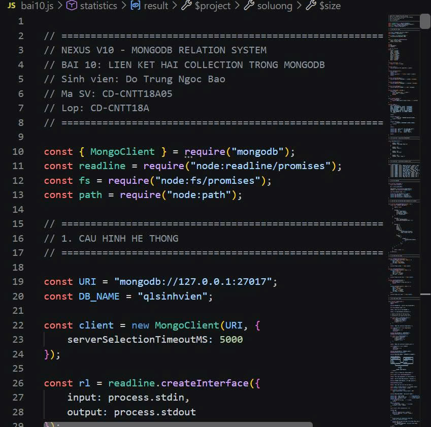
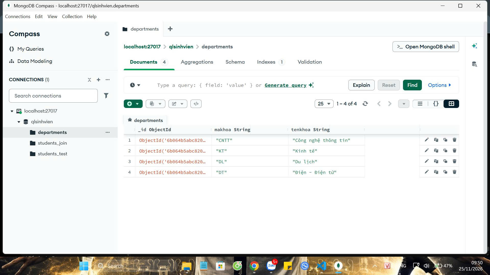
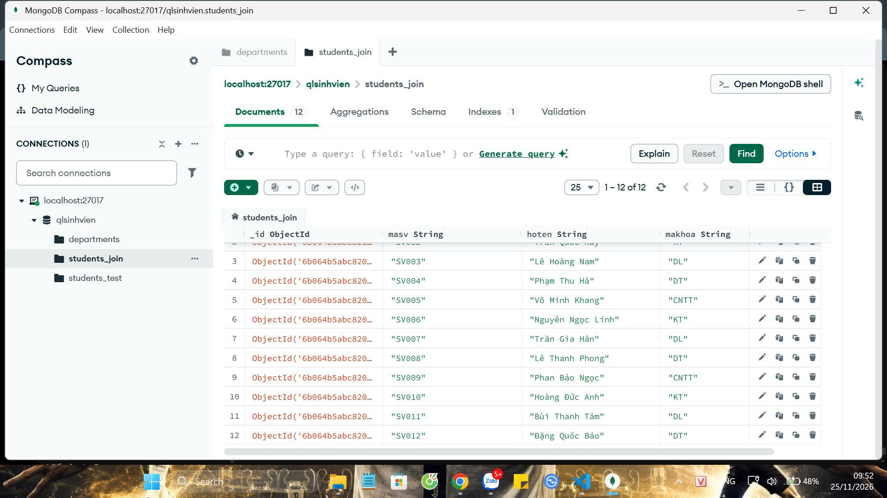
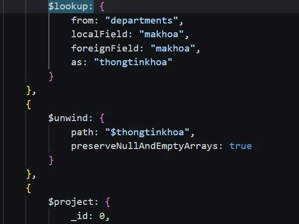
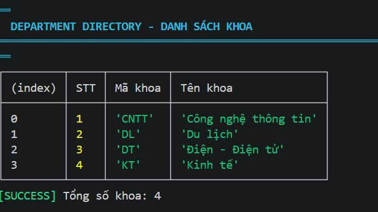
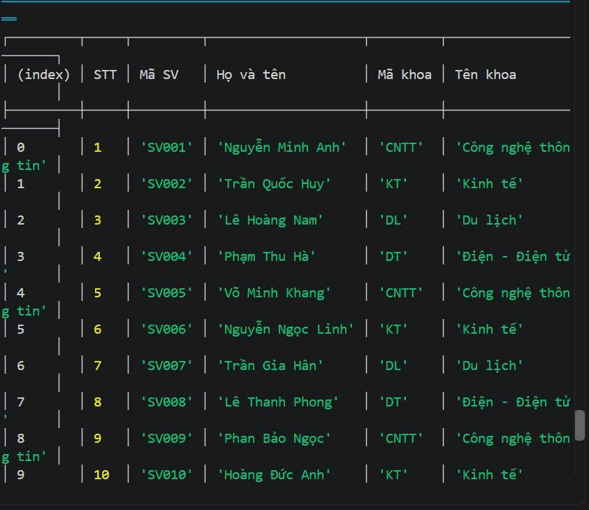
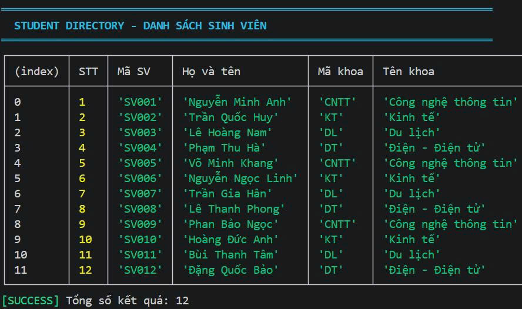
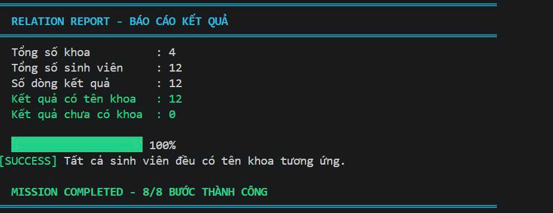
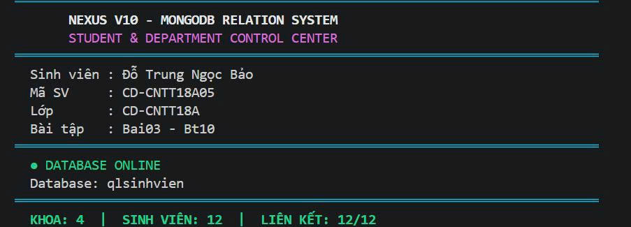
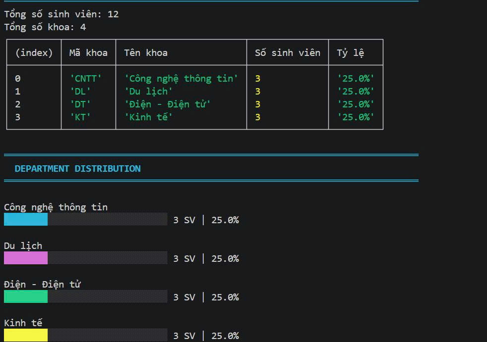

# NEXUS V10 - MONGODB RELATION SYSTEM

## BÀI 10: LIÊN KẾT HAI COLLECTION TRONG MONGODB

---

## 1. Thông tin sinh viên

| Thông tin | Nội dung |
|---|---|
| Họ và tên | Đỗ Trung Ngọc Bảo |
| Mã sinh viên | CD-CNTT18A05 |
| Lớp | CD-CNTT18A |
| Ngành | Công nghệ thông tin |
| Môn học | NodeJS |
| Bài học | Bài 3 - Module, File System và cơ sở dữ liệu |
| Bài thực hành | Bt10 |
| Tên ứng dụng | NEXUS V10 |
| Tập tin chính | bai10.js |

---

## 2. Giới thiệu đề tài

NEXUS V10 là chương trình quản lý sinh viên và khoa
được xây dựng bằng Node.js kết hợp với MongoDB.

Chương trình sử dụng aggregate() và $lookup để liên kết
hai collection departments và students_join thông qua
trường makhoa.

Sau khi liên kết, chương trình hiển thị đầy đủ mã sinh viên,
họ tên, mã khoa và tên khoa tương ứng.

Ngoài các yêu cầu chính của bài thực hành, chương trình
còn được mở rộng với giao diện Terminal màu sắc,
menu chức năng, tìm kiếm, thêm dữ liệu, thống kê
và xuất báo cáo.

---

## 3. Mục tiêu bài thực hành

- Sử dụng Node.js kết nối cơ sở dữ liệu MongoDB.
- Tạo collection departments có ít nhất 2 khoa.
- Tạo collection students_join có ít nhất 4 sinh viên.
- Sử dụng aggregate() kết hợp $lookup.
- Liên kết sinh viên với khoa thông qua makhoa.
- Hiển thị danh sách sinh viên kèm tên khoa.
- Kiểm tra kết quả liên kết dữ liệu.
- Vận dụng module readline, fs và path.
- Xây dựng chương trình có menu tương tác.

---

## 4. Công nghệ sử dụng

| Công nghệ | Công dụng |
|---|---|
| Node.js | Môi trường thực thi JavaScript |
| JavaScript | Ngôn ngữ lập trình |
| MongoDB | Lưu trữ cơ sở dữ liệu |
| MongoDB Driver | Kết nối Node.js với MongoDB |
| MongoDB Compass | Quản lý và kiểm tra dữ liệu |
| Visual Studio Code | Soạn thảo mã nguồn |
| Readline | Nhập lựa chọn từ bàn phím |
| File System | Xuất báo cáo |
| Path | Xử lý đường dẫn tập tin |
| GitHub | Lưu trữ và nộp bài |

---

## 5. Cấu trúc thư mục

```text
NodeJS/
└── Bai03/
    └── Bt10/
        ├── bai10.js
        ├── Readme.md
        ├── package.json
        ├── package-lock.json
        ├── .gitignore
        └── IMAGES/
            ├── 01-Code.png
            ├── 02-Departments.png
            ├── 03-StudentsJoin.png
            ├── 04-Lookup.png
            ├── 05-DanhSachKhoa.png
            ├── 06-DanhSachSinhVien.png
            ├── 07-KetQuaLienKet.png
            ├── 08-KetQua.png
            ├── 09-Menu.png
            └── 10-ThongKe.png
```

Thư mục node_modules được tạo khi cài đặt thư viện
và không đưa lên GitHub.

Thư mục reports được tạo khi sử dụng chức năng
xuất báo cáo.

---

## 6. Thiết kế cơ sở dữ liệu

### 6.1. Thông tin kết nối

- MongoDB URI: mongodb://127.0.0.1:27017
- Database: qlsinhvien
- Collection 1: departments
- Collection 2: students_join
- Trường liên kết: makhoa

### 6.2. Collection departments

Collection departments lưu thông tin các khoa.

| Trường | Kiểu dữ liệu | Ý nghĩa |
|---|---|---|
| _id | ObjectId | Mã định danh MongoDB |
| makhoa | String | Mã khoa |
| tenkhoa | String | Tên khoa |

Dữ liệu mẫu gồm 4 khoa:

| Mã khoa | Tên khoa |
|---|---|
| CNTT | Công nghệ thông tin |
| DL | Du lịch |
| DT | Điện - Điện tử |
| KT | Kinh tế |

### 6.3. Collection students_join

Collection students_join lưu thông tin sinh viên.

| Trường | Kiểu dữ liệu | Ý nghĩa |
|---|---|---|
| _id | ObjectId | Mã định danh MongoDB |
| masv | String | Mã sinh viên |
| hoten | String | Họ và tên sinh viên |
| makhoa | String | Mã khoa của sinh viên |

Dữ liệu mẫu gồm 12 sinh viên:

| Mã SV | Họ và tên | Mã khoa |
|---|---|---|
| SV001 | Nguyễn Minh Anh | CNTT |
| SV002 | Trần Quốc Huy | KT |
| SV003 | Lê Hoàng Nam | DL |
| SV004 | Phạm Thu Hà | DT |
| SV005 | Võ Minh Khang | CNTT |
| SV006 | Nguyễn Ngọc Linh | KT |
| SV007 | Trần Gia Hân | DL |
| SV008 | Lê Thanh Phong | DT |
| SV009 | Phan Bảo Ngọc | CNTT |
| SV010 | Hoàng Đức Anh | KT |
| SV011 | Bùi Thanh Tâm | DL |
| SV012 | Đặng Quốc Bảo | DT |

### 6.4. Sơ đồ liên kết hai collection

```text
DEPARTMENTS                 STUDENTS_JOIN
+--------------+            +--------------+
| _id          |            | _id          |
| makhoa       |<-----------| makhoa       |
| tenkhoa      |            | masv         |
+--------------+            | hoten        |
                            +--------------+
```

Một khoa có thể có nhiều sinh viên.

Hai collection được liên kết bằng trường makhoa.

---

## 7. Các bước thực hiện

### Bước 1: Mở thư mục bài thực hành

Mở Visual Studio Code và chọn thư mục Bt10.

Đường dẫn cá nhân:

```powershell
cd "D:\CD-CNTT18A DoTrungNgocBao\NodeJS\Bai03\Bt10"
```

### Bước 2: Kiểm tra Node.js và npm

```powershell
node -v
npm.cmd -v
```

### Bước 3: Khởi tạo dự án Node.js

```powershell
npm.cmd init -y
```

Lệnh này tạo tập tin package.json.

### Bước 4: Cài đặt thư viện MongoDB

```powershell
npm.cmd install mongodb
```

Thư viện mongodb được sử dụng để kết nối và thao tác
với cơ sở dữ liệu MongoDB.

### Bước 5: Kết nối MongoDB

Mở MongoDB Compass và kết nối bằng URI:

```text
mongodb://127.0.0.1:27017
```

Chương trình sử dụng database qlsinhvien.

### Bước 6: Tạo tập tin bai10.js

Xây dựng chương trình thực hiện các chức năng:

- Kết nối MongoDB.
- Khởi tạo dữ liệu khoa.
- Khởi tạo dữ liệu sinh viên.
- Liên kết hai collection.
- Hiển thị kết quả.
- Xây dựng menu tương tác.
- Thống kê và xuất báo cáo.

### Bước 7: Chạy chương trình

```powershell
node bai10.js
```

Khi chạy, chương trình tự động thực hiện bài thực hành
và hiển thị báo cáo kết quả.

Sau đó nhấn Enter để truy cập menu chính.

### Bước 8: Chạy lại dự án tải từ GitHub

Nếu tải mã nguồn từ GitHub, thực hiện:

```powershell
npm.cmd ci
node bai10.js
```

Yêu cầu MongoDB Server đã được cài đặt và đang chạy.

---

## 8. Giải thích mã nguồn

### 8.1. Khai báo module

```javascript
const { MongoClient } = require("mongodb");
const readline = require("node:readline/promises");
const fs = require("node:fs/promises");
const path = require("node:path");
```

- MongoClient: kết nối MongoDB.
- readline: nhận dữ liệu nhập từ bàn phím.
- fs: thao tác với tập tin.
- path: xử lý đường dẫn.

### 8.2. Khởi tạo kết nối

```javascript
const URI = "mongodb://127.0.0.1:27017";
const DB_NAME = "qlsinhvien";
```

MongoDB được sử dụng trên máy tính cá nhân
thông qua cổng mặc định 27017.

### 8.3. Khởi tạo dữ liệu khoa

Chương trình sử dụng updateOne() kết hợp upsert
để bổ sung dữ liệu mẫu nếu mã khoa chưa tồn tại.

Ví dụ:

```javascript
await departments.updateOne(
    { makhoa: khoa.makhoa },
    { $setOnInsert: khoa },
    { upsert: true }
);
```

Cách thực hiện này giúp hạn chế việc thêm lại dữ liệu
mẫu khi chạy chương trình nhiều lần.

### 8.4. Khởi tạo dữ liệu sinh viên

```javascript
await students.updateOne(
    { masv: sv.masv },
    { $setOnInsert: sv },
    { upsert: true }
);
```

Chương trình kiểm tra mã sinh viên trước khi bổ sung
dữ liệu mẫu vào collection students_join.

### 8.5. Liên kết hai collection bằng aggregate và $lookup

Đây là chức năng chính của bài thực hành.

```javascript
async function getJoinedStudents(filter = {}) {
    return await students.aggregate([
        {
            $match: filter
        },
        {
            $lookup: {
                from: "departments",
                localField: "makhoa",
                foreignField: "makhoa",
                as: "thongtinkhoa"
            }
        },
        {
            $unwind: {
                path: "$thongtinkhoa",
                preserveNullAndEmptyArrays: true
            }
        },
        {
            $project: {
                _id: 0,
                masv: 1,
                hoten: 1,
                makhoa: 1,
                tenkhoa: {
                    $ifNull: [
                        "$thongtinkhoa.tenkhoa",
                        "Chưa có khoa tương ứng"
                    ]
                },
                linked: {
                    $ne: [
                        {
                            $ifNull: [
                                "$thongtinkhoa.makhoa",
                                null
                            ]
                        },
                        null
                    ]
                }
            }
        },
        {
            $sort: {
                masv: 1
            }
        }
    ]).toArray();
}
```

### 8.6. Ý nghĩa các toán tử

| Thành phần | Chức năng |
|---|---|
| aggregate() | Thực hiện chuỗi xử lý dữ liệu |
| $match | Lọc dữ liệu sinh viên |
| $lookup | Liên kết hai collection |
| from | Collection cần liên kết |
| localField | Trường liên kết của sinh viên |
| foreignField | Trường liên kết của khoa |
| as | Tên trường chứa dữ liệu liên kết |
| $unwind | Tách phần tử trong mảng kết quả |
| $project | Lựa chọn các trường hiển thị |
| $ifNull | Xử lý trường hợp không tìm thấy khoa |
| $sort | Sắp xếp kết quả |
| toArray() | Chuyển kết quả thành mảng |

### 8.7. Quy trình xử lý dữ liệu

```text
Khởi động chương trình
          |
          v
Kết nối MongoDB
          |
          v
Khởi tạo departments
          |
          v
Khởi tạo students_join
          |
          v
aggregate() + $lookup
          |
          v
$unwind + $project + $sort
          |
          v
Hiển thị sinh viên và tên khoa
          |
          v
Báo cáo kết quả
          |
          v
Menu chức năng
```

---

## 9. Các chức năng của chương trình

| Mã | Chức năng | Mô tả |
|---|---|---|
| 01 | Chạy bài thực hành | Thực hiện các bước liên kết |
| 02 | Danh sách sinh viên | Hiển thị sinh viên kèm tên khoa |
| 03 | Danh sách khoa | Hiển thị các khoa hiện có |
| 04 | Thêm sinh viên | Bổ sung sinh viên mới |
| 05 | Thêm khoa | Bổ sung khoa mới |
| 06 | Tìm kiếm sinh viên | Tìm theo mã hoặc họ tên |
| 07 | Sinh viên theo khoa | Lọc danh sách theo mã khoa |
| 08 | Cập nhật khoa | Thay đổi khoa của sinh viên |
| 09 | Thống kê | Thống kê sinh viên theo khoa |
| 10 | Xuất báo cáo | Xuất kết quả ra tập tin TXT |
| 11 | Kiểm tra hệ thống | Kiểm tra thông tin kết nối |
| 00 | Thoát | Kết thúc chương trình |

---

## 10. Hình ảnh thực hiện

### 10.1. Mã nguồn chương trình

Tập tin bai10.js được xây dựng bằng JavaScript
trong Visual Studio Code.



### 10.2. Collection departments

Collection departments chứa 4 khoa,
mỗi khoa có makhoa và tenkhoa.



### 10.3. Collection students_join

Collection students_join chứa 12 sinh viên,
mỗi sinh viên có masv, hoten và makhoa.



### 10.4. Mã nguồn liên kết bằng $lookup

Sử dụng aggregate() và $lookup để liên kết
hai collection thông qua trường makhoa.



### 10.5. Danh sách khoa

Hiển thị danh sách 4 khoa trong Terminal.



### 10.6. Danh sách sinh viên trước khi liên kết

Hiển thị thông tin sinh viên và mã khoa.



### 10.7. Kết quả liên kết hai collection

Danh sách sinh viên sau khi thực hiện $lookup
có đầy đủ mã sinh viên, họ tên, mã khoa và tên khoa.



### 10.8. Báo cáo kết quả thực hành

Chương trình hoàn thành 8/8 bước thực hiện.
Tất cả 12 sinh viên đều có tên khoa tương ứng.



### 10.9. Giao diện menu NEXUS V10

Giao diện Terminal cho phép người dùng lựa chọn
các chức năng quản lý và tra cứu dữ liệu.



### 10.10. Thống kê sinh viên theo khoa

Hiển thị số lượng, tỷ lệ và biểu đồ phân bố
sinh viên của từng khoa.



---

## 11. Kết quả thực hiện

### 11.1. Danh sách sinh viên sau khi liên kết

| Mã SV | Họ và tên | Mã khoa | Tên khoa |
|---|---|---|---|
| SV001 | Nguyễn Minh Anh | CNTT | Công nghệ thông tin |
| SV002 | Trần Quốc Huy | KT | Kinh tế |
| SV003 | Lê Hoàng Nam | DL | Du lịch |
| SV004 | Phạm Thu Hà | DT | Điện - Điện tử |
| SV005 | Võ Minh Khang | CNTT | Công nghệ thông tin |
| SV006 | Nguyễn Ngọc Linh | KT | Kinh tế |
| SV007 | Trần Gia Hân | DL | Du lịch |
| SV008 | Lê Thanh Phong | DT | Điện - Điện tử |
| SV009 | Phan Bảo Ngọc | CNTT | Công nghệ thông tin |
| SV010 | Hoàng Đức Anh | KT | Kinh tế |
| SV011 | Bùi Thanh Tâm | DL | Du lịch |
| SV012 | Đặng Quốc Bảo | DT | Điện - Điện tử |

### 11.2. Báo cáo tổng hợp

| Nội dung | Kết quả |
|---|---:|
| Tổng số khoa | 4 |
| Tổng số sinh viên | 12 |
| Tổng kết quả liên kết | 12 |
| Sinh viên có tên khoa | 12 |
| Sinh viên chưa có khoa | 0 |
| Tỷ lệ liên kết | 100% |
| Số bước hoàn thành | 8/8 |

### 11.3. Thống kê theo khoa

| Mã khoa | Tên khoa | Số sinh viên | Tỷ lệ |
|---|---|---:|---:|
| CNTT | Công nghệ thông tin | 3 | 25% |
| DL | Du lịch | 3 | 25% |
| DT | Điện - Điện tử | 3 | 25% |
| KT | Kinh tế | 3 | 25% |
| Tổng cộng | | 12 | 100% |

### 11.4. Biểu đồ phân bố sinh viên

```text
CNTT  ████████  3 SV - 25%
DL    ████████  3 SV - 25%
DT    ████████  3 SV - 25%
KT    ████████  3 SV - 25%
```

---

## 12. Đối chiếu yêu cầu bài thực hành

- [x] Tạo tập tin bai10.js.
- [x] Tạo collection departments có ít nhất 2 khoa.
- [x] Tạo collection students_join có ít nhất 4 sinh viên.
- [x] Sử dụng aggregate().
- [x] Sử dụng $lookup.
- [x] Liên kết thông qua trường makhoa.
- [x] Hiển thị mã khoa và tên khoa tương ứng.
- [x] Chạy bằng lệnh node bai10.js.
- [x] Có tập tin Readme.md.
- [x] Có hình ảnh mã nguồn và kết quả.
- [x] Có đường dẫn thực thi cá nhân.

---

## 13. Ưu điểm và hướng phát triển

### Ưu điểm

- Đáp ứng các yêu cầu chính của bài thực hành.
- Dữ liệu được lưu trữ trong MongoDB.
- Hiển thị kết quả rõ ràng dưới dạng bảng.
- Có menu tương tác với người dùng.
- Có chức năng tìm kiếm và thống kê.
- Có khả năng xuất báo cáo.
- Hạn chế thêm trùng dữ liệu mẫu khi chạy lại.

### Hướng phát triển

- Tạo unique index cho masv và makhoa.
- Bổ sung chức năng sửa và xóa dữ liệu.
- Xây dựng giao diện website quản lý sinh viên.
- Bổ sung chức năng phân trang.
- Xây dựng REST API.
- Bổ sung đăng nhập và phân quyền.

---

## 14. Kết luận

Qua bài thực hành này, sinh viên vận dụng được
kiến thức Node.js và MongoDB để liên kết dữ liệu
giữa hai collection.

Chương trình sử dụng aggregate() kết hợp $lookup
để lấy thông tin tên khoa tương ứng với từng sinh viên.

Kết quả thực hiện trên dữ liệu mẫu gồm 4 khoa,
12 sinh viên và tỷ lệ liên kết thành công 100%.

Chương trình đáp ứng các yêu cầu chính của Bài 10
và có thêm các chức năng hỗ trợ quản lý dữ liệu.

---

## 15. Tác giả

- Sinh viên: Đỗ Trung Ngọc Bảo
- Mã sinh viên: CD-CNTT18A05
- Lớp: CD-CNTT18A
- Môn học: NodeJS
- Bài thực hành: Bai03/Bt10

**NEXUS V10 - MONGODB RELATION SYSTEM**

**MISSION COMPLETED - 100%**

## 16. Hướng dẫn sử dụng chi tiết

### 16.1. Chạy bài thực hành - Chức năng 01

Nhập 01 tại NEXUS COMMAND và nhấn Enter.

Chương trình thực hiện:

1. Kiểm tra kết nối MongoDB.
2. Xác định cơ sở dữ liệu qlsinhvien.
3. Khởi tạo collection departments.
4. Khởi tạo collection students_join.
5. Xác định trường liên kết makhoa.
6. Thực hiện aggregate() và $lookup.
7. Xử lý dữ liệu bằng $unwind và $project.
8. Hiển thị danh sách sinh viên kèm tên khoa.

Kết quả thực tế: hoàn thành 8/8 bước.

### 16.2. Xem danh sách sinh viên - Chức năng 02

Nhập 02 và nhấn Enter.

Chương trình hiển thị danh sách sinh viên gồm:

- Mã sinh viên.
- Họ và tên.
- Mã khoa.
- Tên khoa tương ứng.

### 16.3. Xem danh sách khoa - Chức năng 03

Nhập 03 và nhấn Enter.

Chương trình hiển thị mã khoa và tên khoa
của tất cả các khoa trong cơ sở dữ liệu.

### 16.4. Thêm sinh viên - Chức năng 04

Nhập 04 và nhấn Enter.

Nhập các thông tin theo yêu cầu:

- Mã sinh viên.
- Họ và tên.
- Mã khoa.

Chương trình kiểm tra mã sinh viên đã tồn tại
và kiểm tra mã khoa có hợp lệ hay không.

### 16.5. Thêm khoa - Chức năng 05

Nhập 05 và nhấn Enter.

Nhập mã khoa và tên khoa mới.

Chương trình kiểm tra dữ liệu rỗng
và mã khoa bị trùng trước khi thêm.

### 16.6. Tìm kiếm sinh viên - Chức năng 06

Nhập 06 và nhấn Enter.

Nhập mã sinh viên hoặc họ tên cần tìm kiếm.

Ví dụ: SV001 hoặc Nguyễn Minh Anh.

Kết quả tìm kiếm hiển thị kèm tên khoa.

### 16.7. Xem sinh viên theo khoa - Chức năng 07

Nhập 07 và nhấn Enter.

Nhập mã khoa cần xem.

Ví dụ: CNTT.

Với dữ liệu mẫu ban đầu, kết quả dự kiến gồm:

- SV001 - Nguyễn Minh Anh.
- SV005 - Võ Minh Khang.
- SV009 - Phan Bảo Ngọc.

### 16.8. Cập nhật khoa của sinh viên - Chức năng 08

Nhập 08 và nhấn Enter.

Nhập mã sinh viên và mã khoa mới.

Chương trình kiểm tra dữ liệu và yêu cầu
xác nhận trước khi cập nhật.

### 16.9. Thống kê sinh viên - Chức năng 09

Nhập 09 và nhấn Enter.

Chương trình thống kê:

- Tổng số sinh viên.
- Tổng số khoa.
- Số sinh viên của từng khoa.
- Tỷ lệ phần trăm.
- Biểu đồ phân bố sinh viên.

Kết quả thực tế:

| Khoa | Số sinh viên | Tỷ lệ |
|---|---:|---:|
| Công nghệ thông tin | 3 | 25% |
| Du lịch | 3 | 25% |
| Điện - Điện tử | 3 | 25% |
| Kinh tế | 3 | 25% |
| Tổng cộng | 12 | 100% |


### 16.10. Xuất báo cáo - Chức năng 10

Nhập 10 và nhấn Enter.

Chương trình sử dụng module fs để tạo thư mục
reports và ghi báo cáo vào tập tin:

reports/baocao_bai10.txt

### 16.11. Kiểm tra hệ thống - Chức năng 11

Nhập 11 và nhấn Enter.

Chương trình cung cấp thông tin:

- Phiên bản Node.js.
- Hệ điều hành.
- Đường dẫn chương trình.
- Địa chỉ kết nối MongoDB.
- Tên cơ sở dữ liệu.
- Tên các collection.
- Số lượng dữ liệu.
- Trạng thái kết nối.

### 16.12. Thoát chương trình - Chức năng 00

Nhập 00 và nhấn Enter.

Chương trình kết thúc và đóng kết nối MongoDB.

---

## 17. Phân tích các hàm chính

### 17.1. Hàm connectDB()

Có nhiệm vụ kết nối MongoDB, xác định database
và các collection cần sử dụng.

### 17.2. Hàm getJoinedStudents()

Thực hiện truy vấn aggregate() kết hợp $lookup
để lấy danh sách sinh viên kèm tên khoa.

### 17.3. Hàm showDepartmentTable()

Hiển thị danh sách khoa dưới dạng bảng.

### 17.4. Hàm showStudentTable()

Hiển thị danh sách sinh viên trước khi liên kết.

### 17.5. Hàm showJoinedTable()

Hiển thị danh sách sinh viên sau khi liên kết
với collection departments.

### 17.6. Hàm runExercise()

Thực hiện toàn bộ quy trình bài thực hành,
khởi tạo dữ liệu và báo cáo kết quả.

### 17.7. Hàm menu()

Hiển thị menu và xử lý lựa chọn của người dùng.

### 17.8. Hàm main()

Điều phối toàn bộ chương trình, xử lý lỗi
và đóng kết nối khi kết thúc.

---

## 18. Giải thích nguyên lý liên kết dữ liệu

Giả sử collection students_join có dữ liệu:

```json
{
    "masv": "SV001",
    "hoten": "Nguyễn Minh Anh",
    "makhoa": "CNTT"
}
```

Collection departments có dữ liệu:

```json
{
    "makhoa": "CNTT",
    "tenkhoa": "Công nghệ thông tin"
}
```

Toán tử $lookup so sánh trường makhoa
của sinh viên với trường makhoa của khoa.

Sau khi liên kết và xử lý bằng $project,
kết quả có dạng:

```json
{
    "masv": "SV001",
    "hoten": "Nguyễn Minh Anh",
    "makhoa": "CNTT",
    "tenkhoa": "Công nghệ thông tin",
    "linked": true
}
```

Như vậy, chương trình không chỉ hiển thị mã khoa
mà còn lấy được tên khoa tương ứng.

Đây là nội dung trọng tâm của Bài 10.

---

## 19. Kiểm thử chương trình

### 19.1. Các nội dung đã xác nhận

| STT | Nội dung kiểm thử | Kết quả |
|---:|---|---|
| 1 | Kết nối MongoDB | Thành công |
| 2 | Khởi tạo departments | 4 khoa |
| 3 | Khởi tạo students_join | 12 sinh viên |
| 4 | Thực hiện aggregate và $lookup | Thành công |
| 5 | Hiển thị tên khoa | Thành công |
| 6 | Báo cáo kết quả | 8/8 bước |
| 7 | Hiển thị menu | Thành công |
| 8 | Thống kê sinh viên | Thành công |
| 9 | Tỷ lệ liên kết | 100% |
| 10 | Hình ảnh minh chứng | 10 ảnh |

### 19.2. Các trường hợp kiểm thử mở rộng

Các trường hợp sau được đề xuất để kiểm tra
thêm các chức năng quản lý dữ liệu.

| Trường hợp | Kết quả mong đợi |
|---|---|
| Thêm sinh viên hợp lệ | Thêm thành công |
| Thêm sinh viên trùng mã | Thông báo lỗi |
| Thêm khoa trùng mã | Thông báo lỗi |
| Nhập dữ liệu rỗng | Yêu cầu nhập lại |
| Nhập mã khoa không tồn tại | Thông báo không hợp lệ |
| Tìm kiếm SV001 | Hiển thị sinh viên tương ứng |
| Lọc theo CNTT | Hiển thị sinh viên khoa CNTT |
| Cập nhật khoa hợp lệ | Cập nhật thành công |
| Xuất báo cáo | Tạo tập tin TXT |
| Chọn chức năng không hợp lệ | Thông báo và quay lại menu |

Các chức năng mở rộng cần được kiểm thử riêng
trước khi xác nhận toàn bộ đều hoạt động đúng.

---

## 20. Xử lý lỗi thường gặp

### 20.1. Lỗi Cannot find module 'mongodb'

Nguyên nhân: chưa cài đặt thư viện mongodb.

Cách khắc phục:

```powershell
npm.cmd install mongodb
```

### 20.2. Lỗi ECONNREFUSED 127.0.0.1:27017

Nguyên nhân: MongoDB Server chưa hoạt động
hoặc địa chỉ kết nối không chính xác.

Cách khắc phục:

- Kiểm tra dịch vụ MongoDB trong Windows Services.
- Khởi động MongoDB Server nếu đang dừng.
- Kiểm tra kết nối trong MongoDB Compass.
- Kiểm tra URI mongodb://127.0.0.1:27017.

### 20.3. Lỗi không tìm thấy bai10.js

Nguyên nhân: Terminal đang ở sai thư mục.

Cách khắc phục:

```powershell
cd "D:\CD-CNTT18A DoTrungNgocBao\NodeJS\Bai03\Bt10"
node bai10.js
```

### 20.4. Lỗi npm.ps1 cannot be loaded

Nguyên nhân: PowerShell hạn chế thực thi script.

Sử dụng npm.cmd thay cho npm:

```powershell
npm.cmd install mongodb
```

### 20.5. Hình ảnh không hiển thị trong README

Kiểm tra:

- Tên thư mục IMAGES.
- Tên tập tin ảnh.
- Phần mở rộng .png.
- Đường dẫn tương đối trong Markdown.
- Chữ hoa và chữ thường của tên tập tin.

### 20.6. GitHub báo tải quá 100 tập tin

Nguyên nhân có thể do tải cả node_modules.

Không đưa thư mục node_modules lên GitHub.

Thư viện sẽ được cài đặt lại bằng npm.cmd ci.

---

## 21. Quản lý mã nguồn bằng GitHub

### 21.1. Cấu trúc nộp bài

```text
NodeJS-DoTrungNgocBao/
└── Bai03/
    └── Bt10/
        ├── bai10.js
        ├── Readme.md
        ├── package.json
        ├── package-lock.json
        ├── .gitignore
        └── IMAGES/
```

### 21.2. Nội dung tập tin .gitignore

```gitignore
node_modules/
reports/
.env
```

### 21.3. Các tập tin cần nộp

- bai10.js
- Readme.md
- package.json
- package-lock.json
- .gitignore
- Thư mục IMAGES chứa đầy đủ 10 ảnh.

Không tải node_modules lên GitHub.

Khi tải tập tin bằng giao diện website GitHub,
cần loại node_modules khỏi thư mục dùng để tải lên.

### 21.4. Thông tin repository

- Chủ sở hữu: DoTrungNgocBao
- Repository: NodeJS-DoTrungNgocBao
- Thư mục bài học: Bai03
- Thư mục bài thực hành: Bt10
- Nhánh dự kiến: main

### 21.5. Nội dung commit đề xuất

```text
Hoan thanh Bai03 Bt10 - MongoDB Aggregate Lookup
```

---

## 22. Tài liệu tham khảo

- Bài 3 - Module, File System và cơ sở dữ liệu:
  https://hoctructuyencntt.github.io/NodeJS/Bai03.html

- Node.js Documentation:
  https://nodejs.org/docs/latest/api/

- MongoDB Documentation:
  https://www.mongodb.com/docs/

- MongoDB Lookup:
  https://www.mongodb.com/docs/manual/reference/operator/aggregation/lookup/

- MongoDB Node.js Driver:
  https://www.mongodb.com/docs/drivers/node/current/

- GitHub Documentation:
  https://docs.github.com/

---

## 23. Tổng kết bài thực hành

| Tiêu chí | Yêu cầu | Kết quả |
|---|---|---|
| Tập tin chính | bai10.js | Đáp ứng |
| Số lượng khoa | Tối thiểu 2 | 4 |
| Số lượng sinh viên | Tối thiểu 4 | 12 |
| Trường liên kết | makhoa | Đáp ứng |
| Phương thức | aggregate() | Đáp ứng |
| Toán tử | $lookup | Đáp ứng |
| Hiển thị tên khoa | Bắt buộc | Đáp ứng |
| Lệnh chạy | node bai10.js | Thành công |
| Hình ảnh minh chứng | Có | 10 ảnh |
| Tỷ lệ liên kết | Theo dữ liệu thực tế | 100% |
| Chức năng mở rộng | Không bắt buộc | Có |

---

<div align="center">

# NEXUS V10

### STUDENT & DEPARTMENT CONTROL CENTER

**4 DEPARTMENTS | 12 STUDENTS | 100% LINKED**

**MISSION COMPLETED - 8/8**

Đỗ Trung Ngọc Bảo

CD-CNTT18A05 - CD-CNTT18A

NODEJS - BAI03 - BT10

</div>
