# BÀI 4 – XÂY DỰNG WEB VỚI EXPRESS FRAMEWORK

# NEXUS X – SMART CALCULATOR STUDIO


## 1. Thông tin sinh viên

| Nội dung | Thông tin |
|---|---|
| Họ và tên | Đỗ Trung Ngọc Bảo |
| Mã sinh viên | CD-CNTT18A05 |
| Lớp | CD-CNTT18A |
| Môn học | NodeJS |
| Bài thực hành | Bài 4 – Express Framework |
| Dự án | NEXUS X – Smart Calculator Studio |
| Thư mục nộp | NodeJS/Bai04/Baitapvidu |

## 2. Giới thiệu đề tài

NEXUS X là ứng dụng web máy tính thông minh sử dụng Node.js và Express. Ứng dụng tổ chức mã nguồn theo MVC, sử dụng Pug để tạo giao diện, JSON để lưu lịch sử, Middleware để ghi nhật ký và xử lý lỗi, REST API để trao đổi dữ liệu với trình duyệt. Giao diện theo phong cách dashboard công nghệ với tông màu neon và chế độ sáng/tối.

## 3. Mục tiêu và yêu cầu

- Khởi tạo Web Server bằng Express tại cổng 3000.
- Tổ chức mã nguồn theo Model – View – Controller.
- Sử dụng Router, Pug, Body-parser và Middleware.
- Thực hiện cộng, trừ, nhân, chia; kiểm tra đầu vào và lỗi chia cho 0.
- Lưu lịch sử, thống kê, cung cấp API JSON và xử lý HTTP 404.
- Nộp mã nguồn, Readme.md và ảnh minh chứng trong Bai04/Baitapvidu.

## 4. Công nghệ sử dụng

| Công nghệ | Vai trò |
|---|---|
| Node.js | Môi trường chạy JavaScript phía server |
| Express | Web server, routing, middleware |
| Pug | Template engine tạo HTML |
| Body-parser | Phân tích dữ liệu request |
| JavaScript | Tương tác và gọi API bằng fetch |
| CSS | Bố cục, màu sắc, responsive và theme |
| JSON | Lưu lịch sử tính toán |
| VS Code | Soạn thảo mã nguồn |
| GitHub | Quản lý mã nguồn và nộp bài |

## 5. Chức năng

| Chức năng | Mô tả |
|---|---|
| Dashboard | Tổng quan, máy tính, hoạt động gần đây |
| Máy tính | Bốn phép toán cơ bản |
| Kiểm tra dữ liệu | Thông báo dữ liệu không hợp lệ và chia cho 0 |
| Lịch sử | Hiển thị các phép tính đã lưu |
| Thống kê | Tổng số, thành công, thất bại, tỷ lệ thành công và phân bố phép toán |
| Hệ thống | Thông tin môi trường và kiến trúc |
| Giới thiệu | Thông tin dự án và sinh viên |
| Dark/Light Mode | Chuyển đổi giao diện |
| REST API | Tính toán và trả về thống kê JSON |
| Error Handler | Xử lý đường dẫn không tồn tại |
| Logger | Ghi phương thức, đường dẫn, mã HTTP và thời gian xử lý |

## 6. Cấu trúc thư mục

```text
NodeJS/
└── Bai04/
    └── Baitapvidu/
        ├── controllers/calculatorController.js
        ├── models/calculatorModel.js
        ├── middleware/
        │   ├── logger.js
        │   └── errorHandler.js
        ├── routes/calculatorRoutes.js
        ├── views/
        ├── public/
        │   ├── styles.css
        │   └── script.js
        ├── data/history.json
        ├── IMAGES/
        ├── app.js
        ├── package.json
        ├── package-lock.json
        ├── .gitignore
        └── Readme.md
```

| Tập tin/thư mục | Nhiệm vụ |
|---|---|
| app.js | Khởi tạo Express, cấu hình middleware, view engine và server |
| calculatorModel.js | Tính toán, xử lý lịch sử và thống kê |
| calculatorController.js | Nhận request, gọi Model, trả kết quả |
| calculatorRoutes.js | Khai báo đường dẫn |
| logger.js | Ghi nhật ký request |
| errorHandler.js | Xử lý lỗi |
| views/ | Các template Pug |
| styles.css | Định dạng giao diện |
| script.js | Xử lý tương tác, theme, bàn phím và fetch API |
| history.json | Dữ liệu lịch sử |
| package.json | Thông tin dự án và dependencies |
| package-lock.json | Khóa phiên bản thư viện |
| .gitignore | Loại trừ tập tin không cần đưa lên Git |
| IMAGES/ | 21 ảnh minh chứng |

## 7. Kiến trúc MVC và luồng xử lý

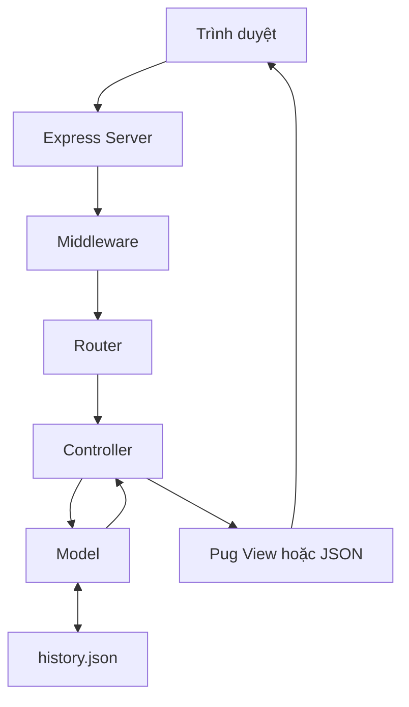

Model xử lý nghiệp vụ; View trình bày dữ liệu; Controller điều phối yêu cầu. Router xác định chức năng theo URL và phương thức HTTP. Middleware hỗ trợ xử lý request, ghi nhật ký và lỗi. Khi thực hiện phép tính, dữ liệu được gửi đến Controller, Model xử lý rồi kết quả được trả về giao diện hoặc JSON.

## 8. Các bước xây dựng dự án

### 8.1. Cài đặt Express và thư viện

Khởi tạo package.json và cài các thư viện cần thiết.

```powershell
npm.cmd init -y
npm.cmd install express pug body-parser
```

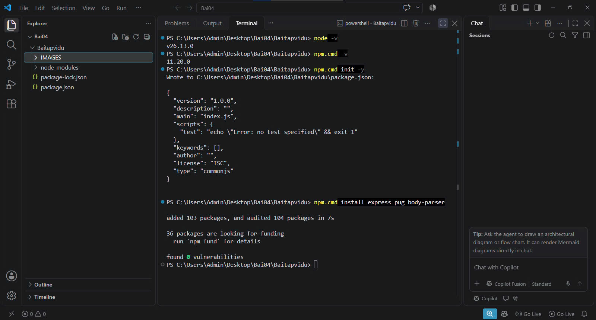

### 8.2. Tạo cấu trúc MVC

Tạo các thư mục controllers, models, views, routes, middleware, public, data và IMAGES.

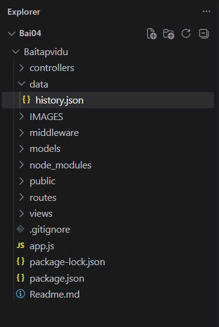

### 8.3. Xây dựng app.js

Cấu hình Express, Pug, static files, middleware và cổng 3000.

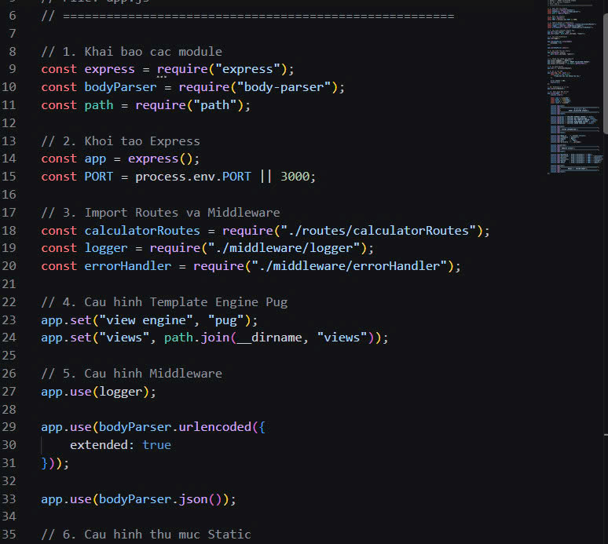

### 8.4. Xây dựng Model

Xử lý bốn phép toán, kiểm tra dữ liệu và lưu lịch sử JSON.

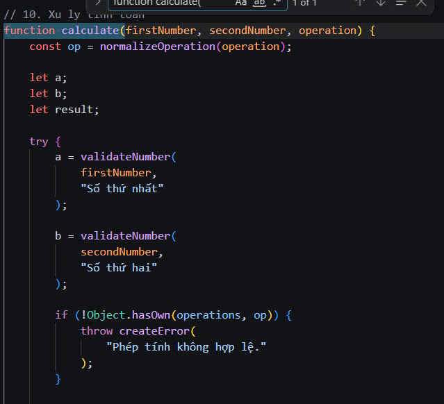

### 8.5. Xây dựng Controller

Tiếp nhận request, gọi Model và trả kết quả.

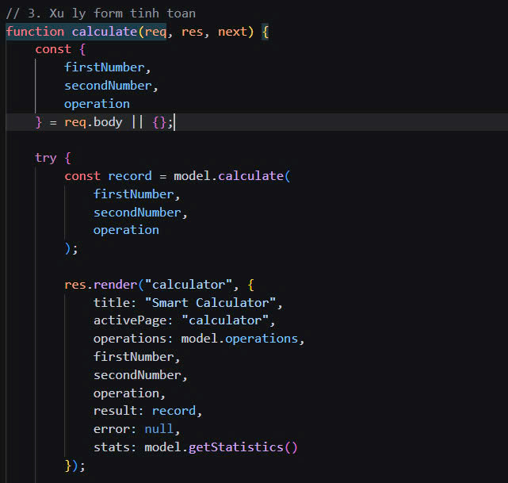

### 8.6. Xây dựng Middleware

Ghi nhật ký request và xử lý lỗi HTTP.

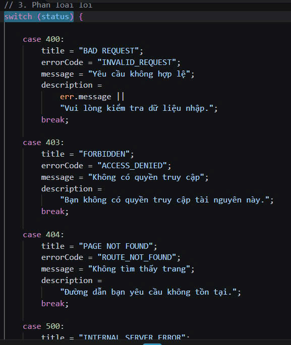

### 8.7. Xây dựng View Pug

Tổ chức các template hiển thị giao diện.

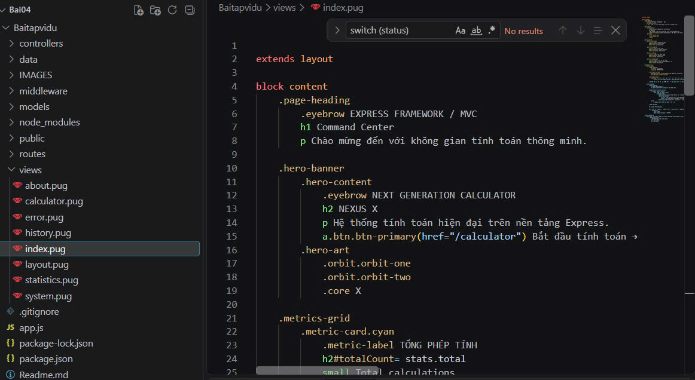

### 8.8. Thiết kế CSS

Thiết kế dashboard, màu neon, bố cục và theme.

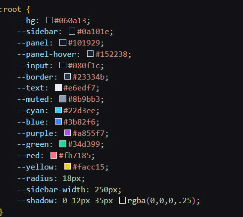

### 8.9. Xây dựng JavaScript

Xử lý máy tính, fetch API, bàn phím và chuyển theme.

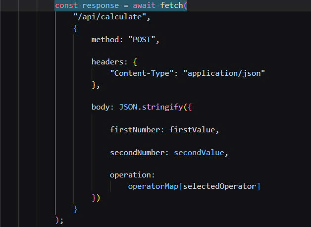

### 8.10. Khởi chạy Server

```powershell
node app.js
```

Mở http://localhost:3000 trên trình duyệt.

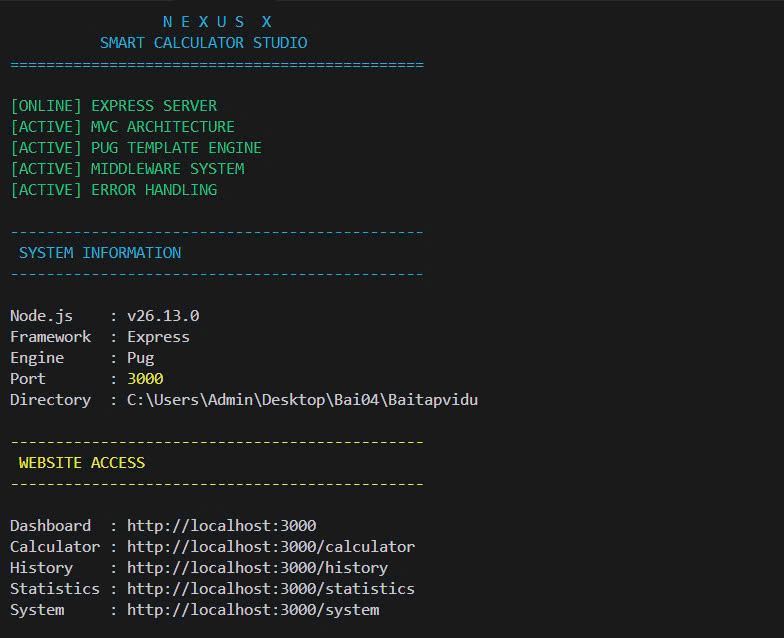

## 9. Routing và REST API

| Method | URL | Chức năng |
|---|---|---|
| GET | `/` | Tổng quan |
| GET | `/calculator` | Máy tính |
| POST | `/calculate` | Xử lý form tính toán |
| GET | `/history` | Lịch sử |
| GET | `/statistics` | Thống kê |
| GET | `/system` | Hệ thống |
| GET | `/about` | Giới thiệu |
| POST | `/api/calculate` | API tính toán |
| GET | `/api/statistics` | API thống kê |

Ví dụ dữ liệu gửi đến POST /api/calculate:

```json
{"firstNumber":120,"secondNumber":30,"operation":"multiply"}
```

Kết quả toán học: 3600. Các giá trị operation gồm add, subtract, multiply, divide.

Ví dụ dữ liệu rút gọn từ API thống kê tại thời điểm kiểm thử:

```json
{"success":true,"data":{"total":4,"success":3,"errors":1,"successRate":75}}
```

API thực tế còn trả về operationStats và recent.

## 10. Hình ảnh giao diện và kết quả

### 10.1. Dashboard

Trang tổng quan và hoạt động gần đây.

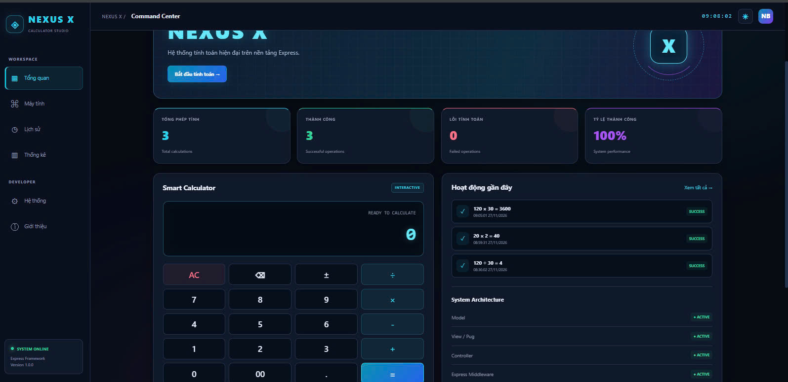

### 10.2. Máy tính

Giao diện nhập số và chọn phép toán.

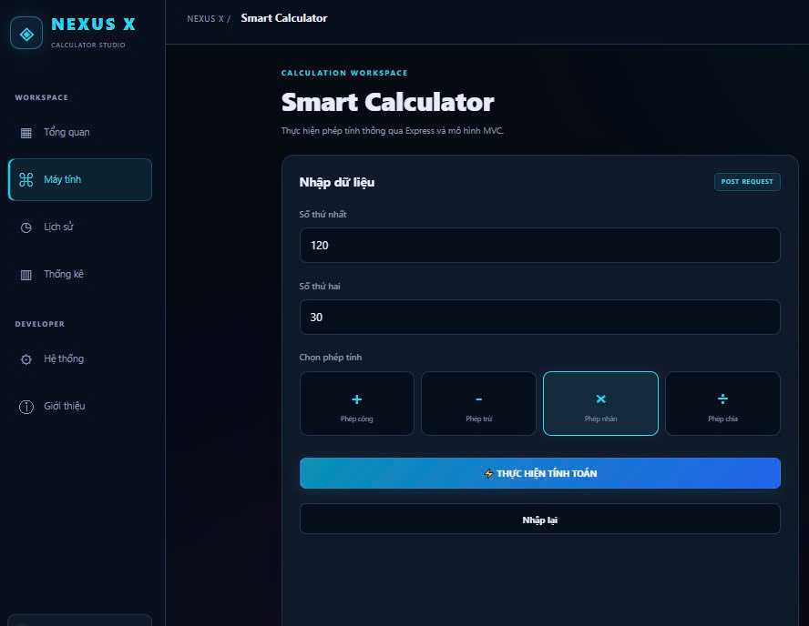

### 10.3. Kết quả tính toán

Hiển thị kết quả phép tính.

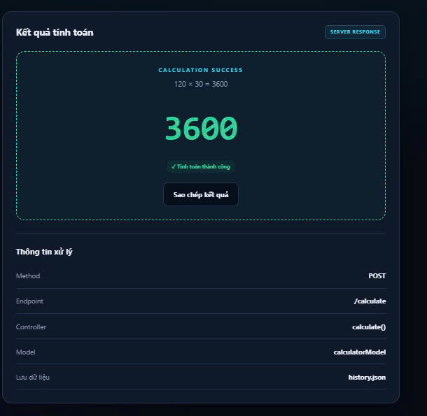

### 10.4. Lỗi chia cho 0

Kiểm tra phép chia không hợp lệ.

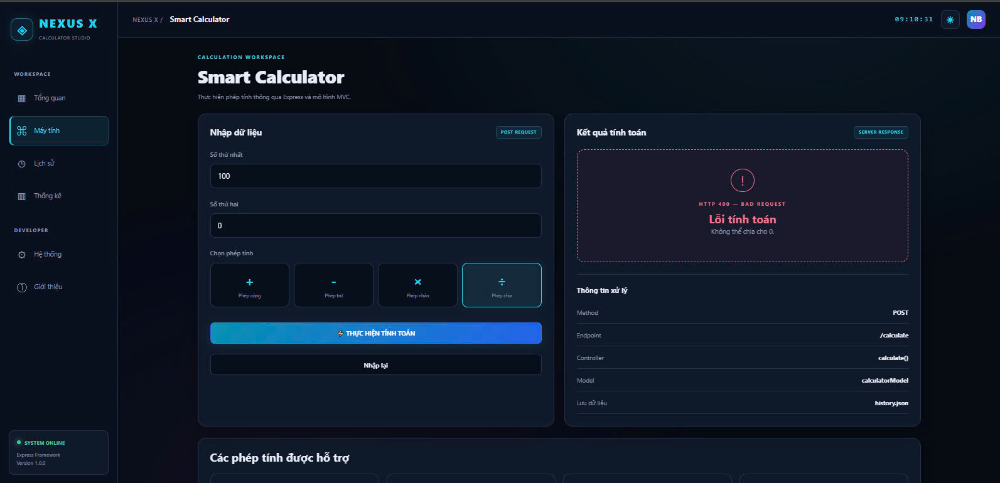

### 10.5. Lịch sử

Danh sách phép tính đã thực hiện.

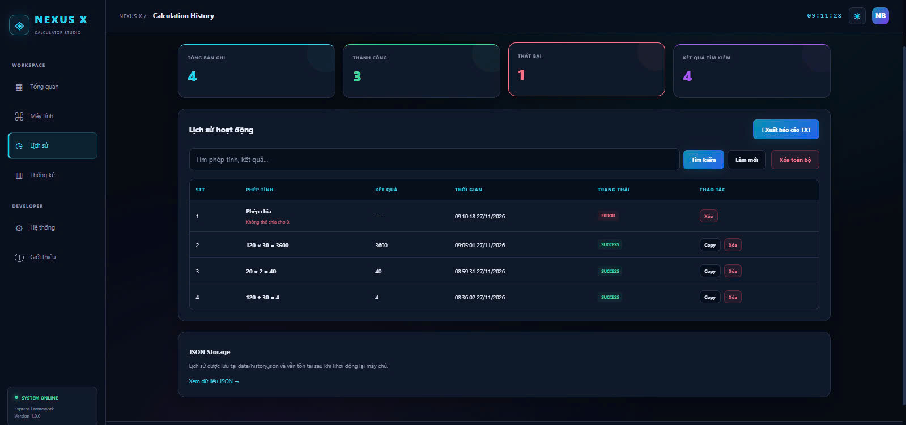

### 10.6. Thống kê

Thống kê số lần thành công và thất bại.

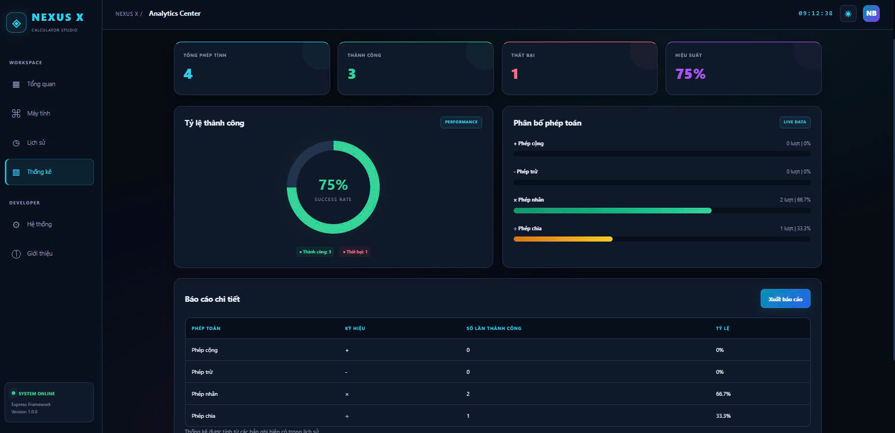

### 10.7. Hệ thống

Thông tin môi trường server.

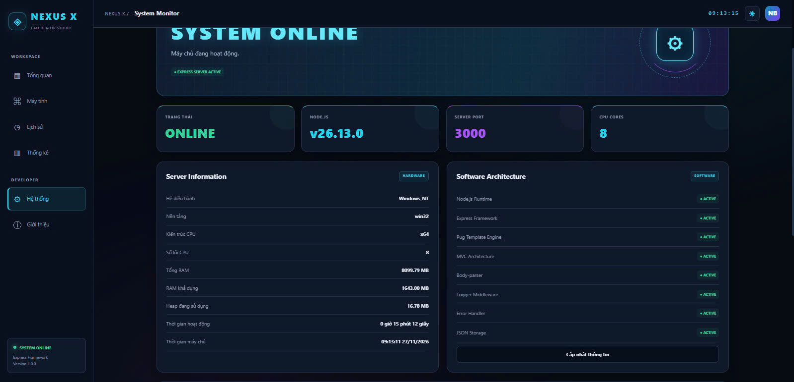

### 10.8. Giới thiệu

Thông tin dự án và sinh viên.

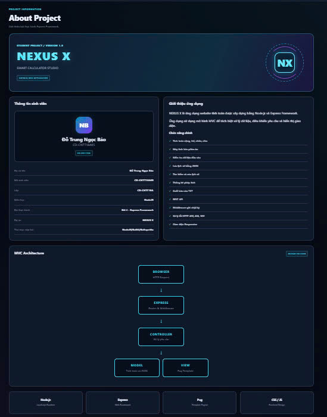

### 10.9. Light Mode

Giao diện sáng.

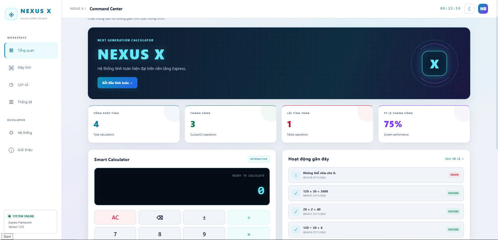

### 10.10. REST API

Dữ liệu JSON từ /api/statistics.

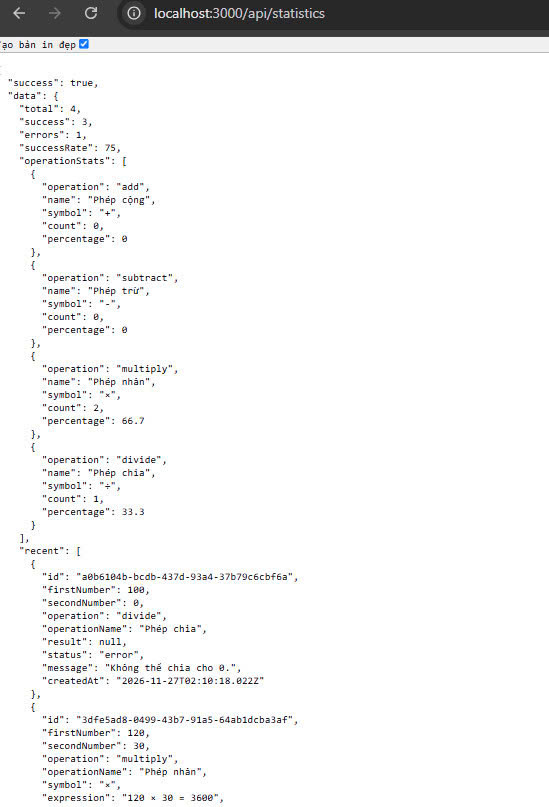

### 10.11. HTTP 404

Kiểm tra xử lý đường dẫn không tồn tại.

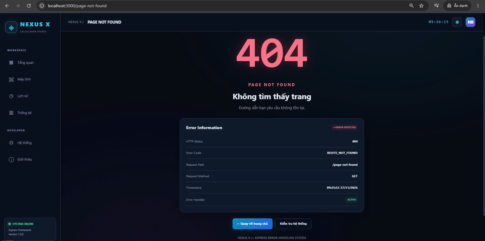

## 11. Kiểm thử

| Ca kiểm thử | Kết quả mong đợi | Kết quả quan sát |
|---|---|---|
| GET / | Hiển thị dashboard | HTTP 200 |
| 20 × 2 | 40 | 40 |
| 120 ÷ 30 | 4 | 4 |
| 120 × 30 | 3600 | 3600 |
| 100 ÷ 0 | Thông báo lỗi | Không thể chia cho 0 |
| GET /api/statistics | JSON thống kê | HTTP 200; 4 phép tính, 3 thành công, 1 lỗi |
| Chuyển theme | Giao diện sáng/tối | Xem ảnh 19 |
| Đường dẫn không tồn tại | HTTP 404 | Xem ảnh 21 |

Tại thời điểm kiểm thử API, tỷ lệ thành công là 75% (3/4). Số liệu thay đổi khi thực hiện thêm phép tính.

## 12. Hướng dẫn chạy lại dự án

Yêu cầu: máy đã cài Node.js và npm. Mở Terminal trong thư mục Baitapvidu.

```powershell
node -v
npm.cmd -v
npm.cmd ci
node app.js
```

Nếu không có package-lock.json, sử dụng npm.cmd install thay cho npm.cmd ci. Mở http://localhost:3000. Dừng server bằng Ctrl+C.

## 13. Nộp bài trên GitHub

Đưa thư mục Baitapvidu vào Bai04 trong repository NodeJS cá nhân. Giữ mã nguồn, package.json, package-lock.json, Readme.md và IMAGES. Không tải node_modules lên GitHub; thư viện được cài lại bằng npm.

Nội dung .gitignore nên có:

```gitignore
node_modules/
.env
npm-debug.log*
```

Kiểm tra README hiển thị đầy đủ ảnh và nộp đường dẫn thư mục Baitapvidu cho giáo viên.

## 14. Kết quả và hạn chế

Dự án đã khởi chạy Express, hiển thị dashboard, thực hiện phép tính, ghi nhận lỗi chia cho 0 và trả dữ liệu thống kê qua REST API. Dữ liệu hiện lưu bằng JSON, phù hợp với bài thực hành cục bộ; chưa phải hệ thống cơ sở dữ liệu nhiều người dùng.

## 15. Hướng phát triển

- Bổ sung phép toán nâng cao và kiểm thử tự động.
- Nâng cấp lưu trữ sang cơ sở dữ liệu.
- Cải thiện khả năng truy cập và triển khai ứng dụng trực tuyến.

## 16. Kết luận

Bài thực hành giúp vận dụng Express Framework, MVC, Router, Middleware, Pug và REST API để xây dựng ứng dụng web hoàn chỉnh ở mức thực hành. NEXUS X kết hợp xử lý phía server với giao diện tương tác phía client.

---

**NEXUS X – SMART CALCULATOR STUDIO**  
**NodeJS – Bài 4 – Express Framework**
